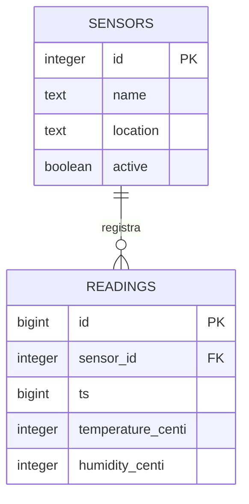
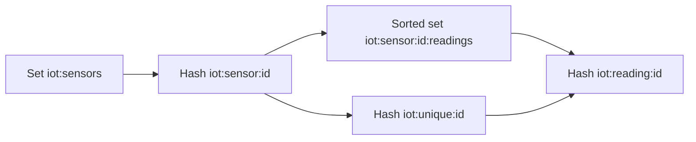

# Entrega 2 - Vantagens, limitações e modelagem

## Problema e regras do domínio

Um campus precisa consultar a temperatura e a umidade de sensores ambientais, localizar uma leitura por ID, inspecionar a evolução temporal de um sensor e identificar períodos de temperatura elevada. Cada sensor pertence a um dos dez locais. Cada registro lógico é uma medição indivisível de temperatura e umidade, associada a um sensor e instante UTC. Os metadados dos sensores e os índices físicos não entram na contagem de um milhão de leituras.

As duas bases aplicam: ID positivo e único, sensor existente, unicidade de sensor/instante, temperatura entre -50 e 100 °C e umidade entre 0 e 100%. Temperatura e umidade usam inteiros em centésimos para evitar divergências de arredondamento. A API Pydantic aplica limites, PostgreSQL reforça com CHECK/FK/UNIQUE e Redis verifica existência/unicidade no script Lua. Clientes que escrevam diretamente no Redis podem contornar parte dessas regras; o contrato exige o uso da API ou dos scripts fornecidos.

O contrato limita IDs de leitura a 9.000.000.000.000.000, IDs de sensor a 2.147.483.647 e timestamps a 253.402.300.799 (fim de 9999 UTC). Assim, os valores são compatíveis com os tipos SQL, o score numérico do Redis e a apresentação de datas. Entradas fora dos limites recebem HTTP 422. A exclusão Redis retorna o registro removido na mesma execução Lua que atualiza os índices.

## Modelo conceitual e relacional

`sensors` guarda metadados sem repeti-los em cada medição. `readings.sensor_id` referencia `sensors.id`. A restrição UNIQUE(sensor_id, ts) impede duas medições no mesmo instante para um sensor. SQL e DDL completos estão em `sql/` e no adaptador `app/store.py`.

| Índice PostgreSQL | Finalidade |
|---|---|
| readings_pkey(id) | Busca pontual e exclusão por ID |
| UNIQUE(sensor_id, ts) | Integridade e buscas por sensor/tempo |
| readings_sensor_ts_idx(sensor_id, ts DESC, id DESC) INCLUDE(temperature_centi, humidity_centi) | Histórico com índice que cobre os campos retornados |
| readings_ts_idx(ts) | Recorte temporal e futuras consultas por período |
| sensors_location_idx(location, id) | Seleção de sensores de um local |

O carregador executa VACUUM (ANALYZE) após a carga para preparar estatísticas e visibilidade. O benchmark preserva os índices e salva EXPLAIN (ANALYZE, BUFFERS, FORMAT JSON) para cada consulta. [14, 15]

## Modelo físico Redis

| Chave / tipo | Conteúdo e responsabilidade |
|---|---|
| iot:sensors / set | IDs dos sensores cadastrados |
| iot:sensor:501 / hash | id, name, location, active |
| iot:reading:500001 / hash | Os cinco campos equivalentes à linha de readings |
| iot:sensor:501:readings / sorted set | Membro = ID da leitura, score = timestamp UTC |
| iot:unique:501 / hash | Campo = timestamp, valor = ID, índice de unicidade |

O Redis não tem FK nativa nesse modelo. O script WRITE_LUA verifica o sensor e o par sensor/instante antes de gravar. Ao atualizar sensor ou timestamp, remove as referências antigas e insere as novas. Ao excluir, remove hash e os dois índices. O teste de integração verifica esse comportamento com bancos reais. Scripts Redis são atômicos em relação à concorrência, mas não fornecem rollback geral de comandos já executados se houver erro de execução. O modelo foi testado sem pressão de memória. [7]

## CRUD equivalente

| Operação | Endpoint com source=postgres ou source=redis | PostgreSQL | Redis |
|---|---|---|---|
| Criar | POST /api/readings | INSERT e restrições | Lua, HSET, ZADD, HSET de unicidade |
| Ler | GET /api/readings/{id} | SELECT pela PK | HGETALL |
| Atualizar | PUT /api/readings/{id} | UPDATE e restrições | Lua remove índices antigos e cria os novos |
| Excluir | DELETE /api/readings/{id} | DELETE | Lua, DEL, ZREM e HDEL |

Cada chamada mutável escolhe explicitamente uma fonte. Não existe transação distribuída entre as bases. Para demonstrar equivalência, `python -m scripts.crud_demo` executa a mesma sequência nas duas fontes, registra `results/crud.json` e remove os registros de demonstração. Alterações manuais devem ser repetidas nas duas fontes antes de verificar e medir. A carga original é reproduzível a partir do CSV e da seed.

## Comparação técnica

| Critério | PostgreSQL | Redis nesta implementação |
|---|---|---|
| Modelo | Relações, schema explícito | Chaves, hashes e índices definidos pela aplicação |
| Relações | FK e JOIN | Referências por IDs, validação no script |
| Consulta | SQL e planejador de execução | Comandos e Lua com caminhos de acesso predefinidos |
| Transações | ACID, MVCC e rollback | Operações atômicas e Lua, sem rollback geral de script |
| Consistência local | Transação e snapshot conforme isolamento | Comando/script atômico na instância única |
| Persistência usada | WAL, fsync e synchronous_commit | AOF everysec, possível janela de perda |
| Índices | Mantidos automaticamente pelo SGBD | Mantidos explicitamente pelo carregador e Lua |
| Escala | Vertical, réplicas e particionamento | Vertical na prática; Cluster exige redesenho deste modelo |
| Melhor adequação | Integridade, relações e agregações | Consultas frequentes por chave e estruturas especializadas |
| Custo adicional | Planejamento, índices e manutenção | RAM, duplicação de índices e validação na aplicação |

## Vantagens, desvantagens e escolha

**Redis:** caminhos simples por chave e estruturas nativas favorecem acessos operacionais. Memória, persistência e réplica têm custo. Consultas não previstas podem exigir novos índices ou varredura. A agregação Lua deste projeto percorre todas as leituras selecionadas e ocupa o servidor durante sua execução. Usar Redis é adequado quando a baixa latência por chave é relevante e a equipe consegue manter as regras e os índices. Evitar como única base de um domínio que dependa de relações complexas e transações com rollback.

**Memcached:** simplicidade, expiração e distribuição de cache favorecem dados reconstruíveis. Seu modelo clássico não substitui a modelagem persistente exigida aqui. A escolha do Redis se baseia na viabilidade de implementar o cenário e os testes, e não em uma afirmação de superioridade universal. [3]

**PostgreSQL:** integridade declarativa, consultas ad hoc e agregações reduzem a complexidade da aplicação. Índices e WAL custam armazenamento e trabalho de escrita. O experimento compara o banco com índices adequados e reconhece vantagens do SQL. [14, 15]

Uma arquitetura de produção plausível manteria histórico e integridade no PostgreSQL e usaria Redis para os acessos operacionais que justificassem seu custo. O experimento mantém cópias completas separadas para atender à comparação acadêmica, sem sincronização contínua ou simulação de telemetria ao vivo.
