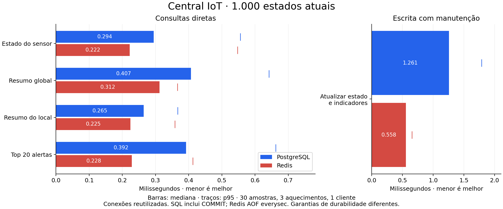

# Central IoT: estado atual e alertas

A remodelagem responde a uma pergunta operacional: **“Como está o campus agora e quais sensores precisam de atenção?”** O Redis guarda o resultado que a tela precisa consultar. O PostgreSQL implementa o mesmo contrato, também com indicadores mantidos na escrita.

O histórico continua disponível para perguntas como “qual foi a média entre duas datas?”. Esse contrato permanece no laboratório histórico; os novos tempos não substituem seus resultados.

## O que existe nos bancos

- **1.000.000 de leituras históricas**, de 1.000 sensores, em cada banco principal.
- **1.000 estados operacionais**: uma posição por sensor, inicializada pela sua última leitura histórica.
- **11 resumos prontos**: um global e dez locais. Cada sensor pertence a um local.
- Redis usa o prefixo `iot:live:v1:`; PostgreSQL usa `live_states`, `live_summaries` e `live_metadata`.

A central passa a evoluir independentemente depois da preparação. O `PUT /api/live/sensors/{id}` substitui o estado atual e atualiza os indicadores; ele não acrescenta uma leitura ao histórico. O laboratório histórico não sincroniza a central automaticamente. O projeto simula eventos pela dashboard, sem coletor físico de sensores.

Contagens variam se você remover estados. Excluir o estado não exclui o cadastro do sensor nem suas leituras históricas. Um novo PUT recria esse estado.

## Como mudou o trabalho de leitura

```text
ANTES — resumo histórico
intervalo → sensores → dados/resumos de cada sensor → combinar → responder

AGORA — estado atual
escrita do sensor → atualizar seu estado + resumo global + resumo local
consulta do painel → ler um hash pronto → responder
consulta de alertas → buscar até 20 posições do índice ordenado → responder
```

| Pergunta | Redis | PostgreSQL |
|---|---|---|
| Estado do sensor 501 | `HGETALL iot:live:v1:sensor:501` | Linha por chave primária em `live_states` |
| Indicadores globais | Um `HGETALL ...:group:all:summary` | Uma linha de `live_summaries` |
| Indicadores do Laboratório | Um `HGETALL ...:group:location:Laboratório:summary` | Linha de resumo desse local |
| 20 maiores temperaturas acima de 32 °C | Faixa do sorted set, limite 20 | Índice de temperatura, `ORDER BY ... LIMIT 20` |

O teste por `INFO commandstats` registrou **dois HGETALL e um ZREVRANGEBYSCORE** para a sequência estado → resumo → alertas. Não houve `EVALSHA`, `SCAN` ou `KEYS` nessas três consultas. Essa contagem é do caminho de dados, com adaptadores já inicializados: cada requisição HTTP também abre sua conexão e verifica o status da central (`GET` no Redis ou `SELECT` de metadados no PostgreSQL). O benchmark reutiliza conexões e exclui essa inicialização nos dois bancos. Existe apenas a conversão dos até 20 resultados retornados em objetos JSON, sem buscar cada sensor novamente.

O hash de estado tem cinco campos e o hash de resumo tem até seis. `HGETALL` percorre os campos desse hash pequeno, não todos os sensores. O ranking tem custo de busca e retorno limitado (`O(log S + K)`, com S sensores e K até 20 na tela).

## Exemplo da manutenção incremental

Imagine que o sensor 501 passe de **28 °C para 36 °C**:

1. A escrita lê apenas o estado anterior desse sensor.
2. Substitui temperatura, umidade e instante no estado atual.
3. Soma **800 centésimos** ao total de temperatura, sem recalcular todas as temperaturas.
4. A contagem de sensores permanece igual. A contagem de alertas aumenta em um, pois cruza o limite estrito de 32 °C.
5. Atualiza o score desse sensor nos rankings global e de seu local.
6. Obtém mínimo e máximo nas extremidades desses índices, inclusive quando o antigo extremo muda ou é removido.

A média resulta de `temperature_sum / count / 100`. Usamos inteiros para evitar acumular erro de arredondamento. Temperaturas iguais pertencem a membros diferentes; apagar um sensor não apaga o outro.

No Redis, um script Lua mantém essas alterações sem intercalar outro cliente. Ele chama a mesma rotina **exatamente duas vezes**, para global e local; não percorre sensores, locais ou histórico. O script utiliza `HINCRBY`, `ZADD`/`ZREM` e consultas das extremidades. A leitura do painel não usa Lua.

No PostgreSQL, a função `live_write` mantém estado, resumos e índices dentro da mesma transação. Ela processa os mesmos dois escopos. Um bloqueio transacional serializa a manutenção do resumo global compartilhado. Os extremos usam consultas ordenadas com `LIMIT 1`, apoiadas pelos índices de temperatura.

As garantias internas de cada banco não tornam a opção **Ambos** uma transação distribuída. A interface manda duas requisições; uma pode concluir e a outra falhar. O console mostra o retorno de cada uma. Alterar apenas um banco produz uma divergência real e intencional.

## Executar no VS Code

Abra a pasta do projeto e use **Terminal → Novo Terminal**:

```bash
cd /home/joey/Documentos/GitHub/trabalho-banco-dados
make up
make preparar-central
make test-central
```

Acesse **http://localhost:8000/#live**. `preparar-central` preserva uma central já pronta. Em uma instalação vazia, execute `make load` entre `make up` e `make preparar-central`; não recarregue a massa já existente.

Para medir e gerar o gráfico:

```bash
make benchmark-central
# Somente na primeira instalação do ambiente de gráficos:
python3 -m venv .venv-graficos
.venv-graficos/bin/pip install -r requirements-graficos.txt
make graficos-central
```

O benchmark guarda o estado original do sensor 501 e o restaura no final. Execute sem demonstrações ou outras escritas concorrentes. O gráfico lê os resultados salvos; ele não faz novos ensaios.

## Roteiro visual para apresentar

1. Na central, deixe **Ambos**, **Indicadores atuais**, **Todos os locais** e clique em **Consultar os bancos**. Os retornos devem ser equivalentes.
2. Clique em **Estado de um sensor** e consulte o 501. Guarde os valores exibidos.
3. Clique em **Preparar alteração**, mantenha **Ambos**, digite **36 °C** e **51%** e grave.
4. Consulte o estado novamente: os dois bancos devem mostrar os mesmos dados e o mesmo instante enviado pela dashboard.
5. Consulte os indicadores e depois **Top 20 alertas**. O contador de alertas considera todos os sensores acima de 32 °C, mas o ranking mostra só os 20 maiores. Um sensor de 36 °C pode não entrar nos 20 primeiros.
6. Para visualizar a divergência, grave **20 °C somente no Redis** e consulte o estado em Ambos. Depois grave os mesmos valores em Ambos para igualá-los.
7. Abra **Ver comandos enviados e JSON** para mostrar a requisição HTTP e a resposta real. O tempo HTTP inclui navegador, API, conexão e banco; não é o mesmo cronômetro do benchmark.
8. A operação **Remover estado atual** demonstra exclusão. Um PUT posterior recria o estado e incrementa novamente a contagem.

## Comandos diretos de consulta

Redis, sem acessar as leituras históricas:

```bash
docker compose exec -T redis redis-cli HGETALL iot:live:v1:sensor:501
docker compose exec -T redis redis-cli HGETALL iot:live:v1:group:all:summary
docker compose exec -T redis redis-cli HGETALL 'iot:live:v1:group:location:Laboratório:summary'
docker compose exec -T redis redis-cli ZREVRANGEBYSCORE iot:live:v1:group:all:temperatures +inf '(3200' WITHSCORES LIMIT 0 20
```

Os membros do ranking são IDs preenchidos com zeros à esquerda. Isso mantém o desempate numérico compatível com `sensor_id DESC` no SQL.

PostgreSQL, com as mesmas perguntas:

```bash
docker compose exec -T postgres psql -U iot -d iot -c 'SELECT * FROM live_states WHERE sensor_id=501;'
docker compose exec -T postgres psql -U iot -d iot -c "SELECT * FROM live_summaries WHERE scope='all';"
docker compose exec -T postgres psql -U iot -d iot -c 'SELECT sensor_id,temperature_centi FROM live_states WHERE temperature_centi>3200 ORDER BY temperature_centi DESC,sensor_id DESC LIMIT 20;'
```

Escrita pelo contrato da aplicação, mantendo os resumos:

```bash
curl -X PUT 'http://localhost:8000/api/live/sensors/501?source=redis' \
  -H 'Content-Type: application/json' \
  -d '{"ts":1900000000,"temperature_centi":3600,"humidity_centi":5100}'
curl 'http://localhost:8000/api/live?source=redis&operation=state&sensor_id=501'
curl 'http://localhost:8000/api/live?source=redis&operation=summary'
curl 'http://localhost:8000/api/live?source=redis&operation=alerts&limit=20'
```

Repita trocando `source=redis` por `source=postgres`. O timestamp é um instante de exemplo, aceito como substituição explícita do estado; a API não rejeita estados fora de ordem. Para simular o instante atual, prefira a dashboard. Não faça `HSET` ou `UPDATE live_states` isoladamente para alterar o estado: isso deixa os indicadores desatualizados. No SQL, a entrada equivalente é `SELECT live_write(501,1900000000,3600,5100,false);`.

## Comparação medida

Execução registrada em **19/11/2026**, com 1.000 estados, três aquecimentos, 30 repetições por cenário/banco, ordem alternada, um cliente e conexões reutilizadas. Os 300 tempos individuais e hashes dos retornos estão em `results/live/samples.json`.

| Operação | PostgreSQL, mediana ms | Redis, mediana ms |
|---|---:|---:|
| Estado de um sensor | 0,294 | 0,222 |
| Resumo global pronto | 0,407 | 0,312 |
| Resumo local pronto | 0,265 | 0,225 |
| Top 20 alertas | 0,392 | 0,228 |
| Atualizar estado, índices e indicadores | 1,261 | 0,558 |



Neste ensaio, Redis teve menor mediana nos cinco cenários. As diferenças de frações de milissegundo oscilam conforme o ambiente. Isso não garante vantagem em toda consulta ou carga.

A comparação mantém o mesmo resultado e o mesmo custo lógico de manutenção nos dois bancos. Há uma diferença de durabilidade: PostgreSQL confirma o commit com `synchronous_commit`; Redis está com `appendfsync everysec`. Portanto, a menor latência de escrita **não demonstra superioridade com a mesma garantia de persistência**. Não desativamos WAL, índices ou fsync do PostgreSQL.

O ensaio de escrita repete o sensor 501 e os mesmos valores. Não mede saturação, distribuição entre milhares de sensores nem vazão com vários clientes. O teste funcional concorrente verifica consistência, não é um benchmark de capacidade. Os testes históricos de 1M/5M permanecem em `results/escala/`; eles não medem este novo contrato de 1.000 estados.

## Planos de execução

`results/live/benchmark.json` guarda `EXPLAIN (ANALYZE, BUFFERS, FORMAT JSON)`:

- Estado: **Index Scan** por `live_states_pkey`.
- Resumo: **Seq Scan de somente 11 linhas de resumo**, escolhido pelo otimizador; não há varredura das 1.000.000 leituras.
- Ranking: **Limit → Index Only Scan** em `live_temperature_idx`; o plano registrado ainda precisou de acessos ao heap para visibilidade.

Não forçamos `enable_seqscan=off`. Uma tabela de 11 linhas pode ser mais barata de ler inteira que por índice. Para reproduzir:

```bash
docker compose exec -T postgres psql -U iot -d iot -c 'EXPLAIN (ANALYZE,BUFFERS) SELECT sensor_id,temperature_centi FROM live_states WHERE temperature_centi>3200 ORDER BY temperature_centi DESC,sensor_id DESC LIMIT 20;'
```

Redis não produz o plano relacional do PostgreSQL. Mostramos os comandos executados, a estrutura acessada e sua complexidade, sem inventar um `EXPLAIN` SQL.

## Testes, manutenção e limites

`make test-central` verifica igualdade com recomputação independente, mudança do limite de alerta, substituição repetida sem duplicar contagem, extremos duplicados, exclusão idempotente, local vazio/recriação, atualizações aleatórias e concorrentes, validação, HTTP e proteção da carga. Os testes restauram os estados usados.

O cadastro de local dos sensores é fixo nesta versão. Alterar esse cadastro diretamente exige migrar a central; a função recusa atualização se detectar mudança de local. Os resumos e índices são estruturas redundantes e só ficam coerentes se a escrita passar pela API/função prevista.

A preparação percorre uma única vez a última leitura de cada sensor e confere a igualdade das duas origens. Ela não é executada em cada consulta. Se a preparação for interrompida, o status bloqueia a central; preserve os dados e examine o erro antes de recuperá-la. Não use `FLUSHDB` como reparo.

O resumo global é um ponto compartilhado de escrita. Uma carga intensa pode exigir agregação por partição e composição assíncrona, com outro contrato de consistência. O script atual foi projetado para Redis standalone; não é uma implementação de Redis Cluster. Não há TTL automático: expirar um hash isolado quebraria a contagem, por isso a remoção usa a operação que mantém os indicadores.

O carregador recusa `--replace` quando existe uma central, para não descartar estados acidentalmente. Somente se quiser substituir **todo o histórico e também todos os estados atuais**, use `--replace --replace-live`; em seguida execute `make preparar-central` e refaça índices/medições necessários. Esse procedimento destrói as alterações operacionais anteriores e não é necessário para iniciar o projeto.

## Trechos para mostrar na apresentação

- `app/live.py`, métodos `latest`, `summary` e `alerts`: consultas Redis curtas e acesso equivalente no PostgreSQL.
- `app/live.py`, `WRITE_LUA`: diferenças entre estado antigo e novo, `HINCRBY`, `ZADD` e as duas chamadas `adjust`.
- `sql/live.sql`, função `live_write`: mesma manutenção dentro de uma transação SQL.
- `scripts/benchmark_live.py`: aquecimento, alternância, comparação dos retornos, restauração e mediana/p95.
- `tests/live/test_live.py`: comparação dos indicadores armazenados com uma recomputação independente.

Fontes técnicas: [HINCRBY](https://redis.io/docs/latest/commands/hincrby/), [ZRANGE](https://redis.io/docs/latest/commands/zrange/) e [bloqueios PostgreSQL 17](https://www.postgresql.org/docs/17/explicit-locking.html). Os resultados numéricos são medições locais deste repositório.
