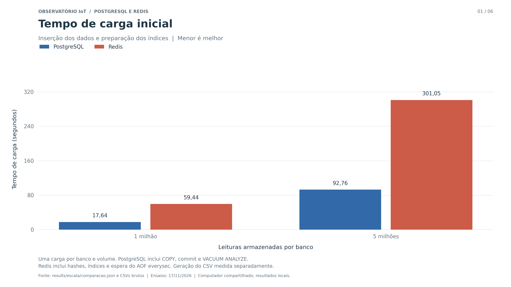
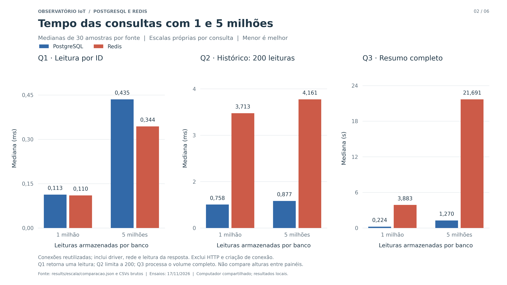
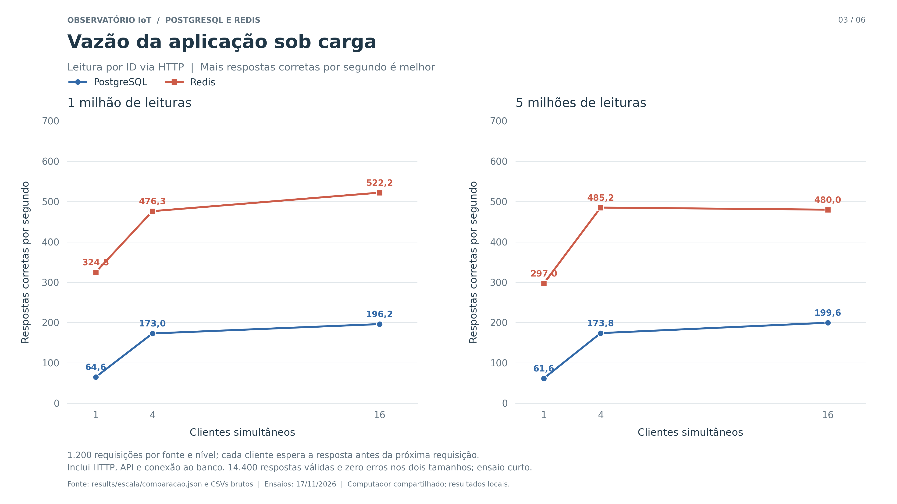
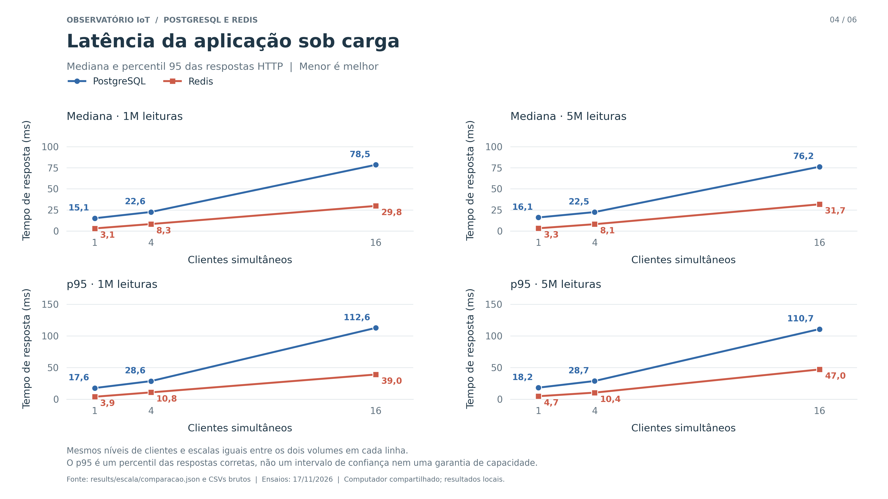
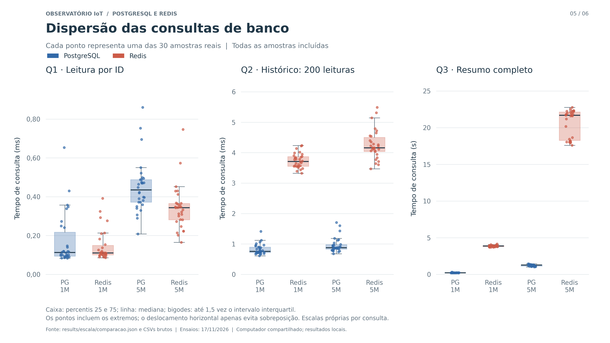
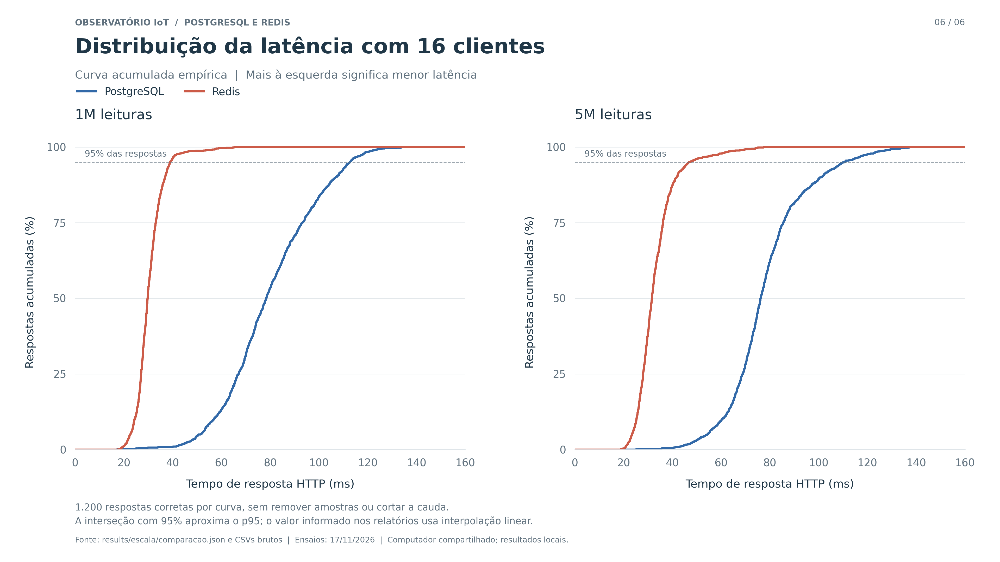

# Gráficos em Python dos testes de carga e volume

Os seis gráficos foram gerados com **Python e Matplotlib**, usando as medições já executadas com **1 milhão e 5 milhões de leituras por banco**. A geração dos gráficos lê arquivos locais e não dispara novos testes ou alterações nos bancos.

São **360 amostras de consultas** e **14.400 respostas HTTP**. O script recalcula e confere medianas, p95, contagens e vazão com os CSVs e os relatórios antes de desenhar. As cargas iniciais têm uma medição por banco e tamanho.

## Gerar novamente no terminal do VS Code

Abra a raiz do projeto e prepare o ambiente de gráficos:

```bash
cd /home/joey/Documentos/GitHub/trabalho-banco-dados
python3 -m venv .venv-graficos
.venv-graficos/bin/python -m pip install -r requirements-graficos.txt
make graficos
```

Nas próximas execuções, basta `make graficos`. Sem Make:

```bash
.venv-graficos/bin/python -m scripts.plot_load_tests
```

Para PNGs a 300 DPI, mantendo o PDF e os SVGs vetoriais:

```bash
.venv-graficos/bin/python -m scripts.plot_load_tests --dpi 300
```

A dependência é de autoria e está separada das bibliotecas da aplicação Docker. Não é necessário iniciar os bancos para gerar gráficos das evidências já salvas.

## Arquivos entregues

- **PNG:** `output/graficos/`, resolução padrão de 3840 × 2160 pixels, proporção 16:9 para inserir nos slides.
- **SVG:** mesma pasta, versão vetorial de cada gráfico para ampliar.
- **PDF:** [seis gráficos reunidos](../output/pdf/Graficos_Carga_1M_5M.pdf), um por página.
- **ZIP local:** `output/Graficos_Carga_1M_5M.zip`, com as imagens e o PDF para copiar de uma vez. É gerado pelo script e fica fora do Git; os arquivos individuais estão versionados.
- **Código:** [scripts/plot_load_tests.py](../scripts/plot_load_tests.py).
- **Conferência e hashes:** [manifesto dos gráficos](../results/graficos/manifesto_graficos.json).

## O que explicar em cada gráfico

| Gráfico | Dados usados | Fala sugerida |
|---|---|---|
| 1. Tempo de carga | Tempo do carregador, por banco e volume | “Aqui medimos inserir os dados e preparar os índices. São cargas iniciais, uma por cenário.” |
| 2. Medianas das consultas | 30 amostras por consulta, banco e volume | “Q1 retorna uma leitura; Q2 retorna até 200; Q3 processa o período completo. O efeito do volume muda conforme a operação.” |
| 3. Vazão HTTP | Sucessos divididos pelo tempo total de cada nível | “Mais clientes podem aumentar as respostas por segundo. Este teste mede a aplicação, incluindo HTTP e conexão ao banco.” |
| 4. Mediana e p95 HTTP | 1.200 respostas por banco e nível | “A vazão pode crescer junto com a espera. O p95 mostra a cauda da latência e não é um intervalo de confiança.” |
| 5. Dispersão das consultas | Todas as 30 amostras de cada grupo | “Cada ponto é uma medição. A caixa mostra os percentis 25 e 75, e a linha central mostra a mediana.” |
| 6. Distribuição HTTP | Todas as 1.200 respostas por fonte, com 16 clientes | “A curva mostra a proporção acumulada de respostas até cada tempo. Quanto mais à esquerda, menor a latência nesse ensaio.” |

## 1. Tempo de carga inicial



O PostgreSQL passou de **17,64 s** para **92,76 s**; o Redis, de **59,44 s** para **301,05 s**. O primeiro inclui COPY, commit e VACUUM ANALYZE; o segundo inclui hashes, índices, pipeline e espera do AOF everysec. A geração do CSV é separada. Esses valores descrevem os carregadores e as configurações do projeto.

## 2. Medianas das consultas



Cada painel tem escala própria e informa a unidade: **milissegundos em Q1/Q2** e **segundos em Q3**. Compare os bancos e volumes dentro do mesmo painel. A mediana do resumo de 5 milhões foi **1,270 s no PostgreSQL** e **21,691 s no Redis**.

## 3. Vazão com clientes simultâneos



As duas bases usam a mesma escala vertical. No cenário de um milhão, de 1 para 16 clientes, o PostgreSQL passou de **64,6 para 196,2 sucessos/s**; o Redis, de **324,8 para 522,2 sucessos/s**. São leituras por ID, com abertura de conexão por requisição na aplicação. Não são medidas da capacidade máxima de cada servidor de banco.

## 4. Mediana e p95 das respostas HTTP



Os volumes têm a mesma escala dentro de cada linha. Com 16 clientes e um milhão de leituras, o p95 foi **112,6 ms no PostgreSQL** e **39,0 ms no Redis**. Esses tempos incluem HTTP, API e conexão; o benchmark Q1 de banco reutiliza conexões e mede uma fronteira diferente.

## 5. Variação das consultas



Todos os valores aparecem como pontos, inclusive os extremos. O pequeno deslocamento horizontal evita sobreposição e não altera o tempo medido. Os bigodes alcançam até 1,5 vez o intervalo entre os percentis 25 e 75. As escalas variam entre consultas.

## 6. Curva acumulada com 16 clientes



O eixo horizontal mostra tempo em milissegundos; o vertical, a porcentagem acumulada de respostas. A linha de 95% permite visualizar a região do p95. A curva empírica é uma escada; os números dos relatórios usam interpolação linear para calcular o percentil.

## Método e limites

Os ensaios usam um computador compartilhado e cache aquecido. A carga HTTP é fechada: cada cliente espera a resposta antes da próxima requisição. As linhas conectam níveis medidos de 1, 4 e 16 clientes; não são um modelo que prevê desempenho entre eles. O ensaio é curto e não executa estresse até falhar. Há zero erros nas 14.400 respostas medidas.

As fontes são `results/escala/comparacao.json`, `load.json`, `verification.json`, `benchmark_raw.csv` e `concurrent_load_raw.csv` de cada cenário. O manifesto registra os hashes de entrada e saída, as versões de Python/Matplotlib e o hash do script. O script não usa os tempos do EXPLAIN como se fossem latências HTTP.

Os detalhes dos ensaios e seus comandos estão em [TESTES_CARGA_1M_5M.md](TESTES_CARGA_1M_5M.md). Referências da biblioteca: [exportação de figuras](https://matplotlib.org/3.10.8/api/_as_gen/matplotlib.pyplot.savefig.html) e [PDF com várias páginas](https://matplotlib.org/3.10.8/api/backend_pdf_api.html).
