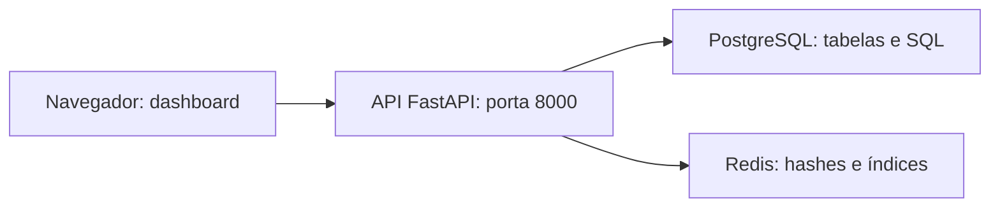

# Funcionamento do projeto e explicação dos exemplos

## O que foi implementado

O Observatório IoT é uma aplicação acadêmica que consulta dados sintéticos de temperatura e umidade de um campus. Há **1.000.000 de leituras**, de **1.000 sensores em dez locais**, representadas em PostgreSQL e Redis. A amostragem simulada ocorre a cada cinco minutos; os horários são UTC.

O trabalho reúne pesquisa sobre chave-valor/cache, modelagem nos dois bancos, carga determinística, verificação integral dos registros, CRUD, três consultas de benchmark, dashboard e exemplos didáticos. Há 11 testes de integração da aplicação e três testes dos exemplos com Redis real. Os resultados anteriores estão em [results/tests.log](../results/tests.log), [results/exemplos_redis_tests.log](../results/exemplos_redis_tests.log) e [results/verification.json](../results/verification.json).

A apresentação no Canva tem **14 slides**. O bloco da entrega de 17/11 ocupa os slides 8–14: vantagens, problema, modelo relacional, modelo Redis, comparação dos modelos, prática Redis e exemplos no GitHub.

## Como está rodando

O [Compose](../compose.yaml) inicia três serviços no computador:

| Serviço | Função | Endereço local |
|---|---|---|
| Aplicação Python/FastAPI | API e página HTML/CSS/JavaScript | http://localhost:8000 |
| PostgreSQL | Tabelas, restrições, índices e consultas SQL | localhost:55432 |
| Redis | Hashes, sets, índices temporais e scripts Lua | localhost:56379 |



O navegador chama a API; a API consulta o banco selecionado. A função de comparação lê o mesmo ID nas duas bases, confere os campos e mostra o tempo de cada consulta. Os bancos guardam seus dados em volumes Docker. Parar e retomar os serviços preserva a carga.

### Executar em outro computador

Com Git, Docker, Compose e Make disponíveis:

```bash
git clone https://github.com/JoeyAlanS/projeto-nosql-redis-postgresql.git
cd projeto-nosql-redis-postgresql
make up
make load       # primeira carga nesta instalação
```

O repositório é privado: o clone exige uma conta com acesso. Abra **http://localhost:8000**. A documentação interativa da API fica em **http://localhost:8000/docs**. Nas próximas execuções, basta `make up`. Os exemplos Redis abaixo funcionam mesmo sem executar `make load`.

## Exemplo 1 — CRUD de uma leitura com hash

Arquivo completo: [01_crud_hash.py](../exemplos/redis/01_crud_hash.py). Trecho da função `executar`, com os campos da leitura:

```python
banco.hset(chave, mapping={
    "id": 1, "sensor_id": 1, "ts": 1793491200,
    "temperature_centi": 2850, "humidity_centi": 6100,
})
criada = banco.hgetall(chave)
banco.hset(chave, "temperature_centi", 3300)
atualizada = banco.hgetall(chave)
banco.delete(chave)
excluida = not banco.exists(chave)
```

`HSET` cria o hash com os cinco campos. `HGETALL` lê todos os campos. O segundo `HSET` atualiza somente a temperatura. `DEL` exclui a chave; `EXISTS` verifica que ela foi removida.

Os valores usam centésimos: **2850 = 28,50 °C**, **3300 = 33,00 °C** e **6100 = 61,00%** de umidade. A conexão usa `decode_responses=True`, por isso os valores lidos pelo cliente Python são textos, como `"2850"`.

Na demonstração, destaque a passagem de 2850 para 3300 e o resultado `excluida: true`.

## Exemplo 2 — Histórico por sensor e período

Arquivo completo: [02_historico_sensor.py](../exemplos/redis/02_historico_sensor.py). Comandos centrais:

```python
banco.zadd(indice, {str(numero): instante})
ids = banco.zrangebyscore(indice, inicio + 300, inicio + 600)
leituras = [banco.hgetall(f"{prefixo}:leitura:{i}") for i in ids]
```

O programa cria três leituras às **00:00, 00:05 e 00:10 UTC de 01/11/2026**. Cada leitura fica em um hash. O sorted set funciona como índice: o membro é o ID e o score é o timestamp.

`ZRANGEBYSCORE` busca pelo intervalo inclusivo de 00:05 a 00:10. Ele retorna **IDs 2 e 3**, em ordem temporal. Depois, `HGETALL` recupera os campos dos dois hashes. As temperaturas retornadas são **29,00 °C e 29,50 °C**.

Explique que o índice guarda IDs e instantes; ele não substitui os hashes com os valores das leituras.

## Exemplo 3 — Cache com expiração

Arquivo completo: [03_cache_ttl.py](../exemplos/redis/03_cache_ttl.py). Trecho central:

```python
ausente_antes = banco.get(chave) is None
resumo = {"sensor_id": 1, "leituras": 3, "temperatura_media": 29.0}
banco.set(chave, json.dumps(resumo), ex=2)
acerto = json.loads(banco.get(chave))
ttl = banco.ttl(chave)
```

A primeira leitura mostra uma ausência no cache. `SET` guarda o resumo como JSON, e `ex=2` define validade de dois segundos. O próximo `GET` encontra o valor. `TTL` informa o tempo restante. O restante do programa espera de forma limitada e verifica `expirou: true`.

O resumo é fixo e didático; este exemplo não consulta o PostgreSQL. No projeto principal, as chaves `iot:*` não expiram, porque preservam o histórico para as consultas e a comparação.

## Comparação com PostgreSQL no código principal

No arquivo [app/store.py](../app/store.py), a consulta por ID aparece de duas formas:

```python
# PostgresStore.point: consulta SQL parametrizada
return self.conn.execute(
    "SELECT * FROM readings WHERE id=%s", (reading_id,)
).fetchone()

# RedisStore.point: acesso ao hash e conversão dos campos para inteiros
return normalized(self.conn.hgetall(f"iot:reading:{reading_id}"))
```

As duas funções recebem o mesmo ID e devolvem os mesmos cinco campos lógicos. No PostgreSQL, a chave primária e o índice sustentam a busca. No Redis, a própria chave identifica o hash.

Para alterações completas, PostgreSQL usa comandos SQL e restrições; Redis usa o script `WRITE_LUA` para verificar o sensor, impedir repetição do par sensor/instante e manter os hashes e índices na mesma execução atômica. Isso é mais completo que a sequência curta do exemplo 1. Não há transação distribuída entre os dois bancos.

## O que executar durante a apresentação

```bash
make exemplos-redis      # três demonstrações curtas
make crud               # criar, ler, atualizar e excluir nos dois bancos
make test-exemplos-redis # três testes dos exemplos
make test               # onze testes da aplicação
```

No `make crud`, uma leitura temporária passa de **29 para 34 °C** e é excluída nas duas fontes. O programa confere os valores criados e atualizados e a ausência após exclusão. O resultado esperado é `passed: true` para PostgreSQL e Redis, além de `equivalent: true`.

Na página, busque o ID **500001** em **Uma leitura, dois bancos**. O resultado é sensor 1, temperatura **30,59 °C**, umidade **45,73%** e instante **02/11/2026 17:40 UTC**. O painel arredonda a umidade para 45,7%. Os tempos ao vivo variam; o experimento com repetições está explicado em [docs/04_experimentos.md](04_experimentos.md).

Cada exemplo Redis usa chaves exclusivas com UUID e faz limpeza em `finally`. A conexão compartilhada está em [_conexao.py](../exemplos/redis/_conexao.py). Os exemplos não modificam a massa de um milhão de leituras.
