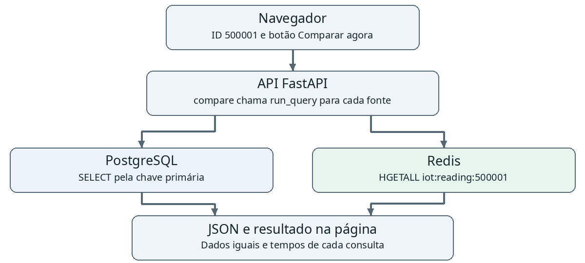

# Manual do Observatório IoT

## 1 O trabalho e a quantidade de registros

Este manual explica o projeto de Bancos de Dados NoSQL, demonstra o fluxo de leitura e apresenta as operações que podem ser executadas no VS Code. O cenário é um campus simulado com sensores de temperatura e umidade. Os dados são sintéticos e reproduzíveis; não vêm de equipamentos físicos conectados ao computador.

**A base possui 1.000.000 de leituras e 1.000 sensores em cada banco.** PostgreSQL e Redis guardam duas representações das mesmas medições. Portanto, o conjunto do experimento tem um milhão de medições distintas, representadas nas duas bases.

| Contagem | PostgreSQL | Redis |
|---|---|---|
| Leituras ambientais | 1.000.000 linhas em readings | 1.000.000 hashes iot:reading:* |
| Sensores | 1.000 linhas em sensors | 1.000 hashes de sensores |
| Objetos de domínio por base | 1.001.000 | 1.001.000 |
| Leituras de cada sensor | 1.000 | 1.000 |
| Locais do campus | 10 | Os mesmos 10 locais |
| Chaves físicas totais | Não se aplica | 1.003.003 na verificação atual |

Os índices, conjuntos e metadados Redis explicam por que existem mais chaves que leituras. Eles não são novas medições. A contagem atual foi conferida em 16/11/2026; a verificação integral anterior, registrada em results/verification.json, comparou todas as leituras e os índices com o CSV original.

### Características da massa

Cada leitura contém id, sensor_id, ts, temperature_centi e humidity_centi. O timestamp representa segundos UTC. Temperatura e umidade usam centésimos: 3059 representa 30,59 °C e 4573 representa 45,73%.

A massa usa seed 42 e intervalo de cinco minutos por sensor. O período vai de 01/11/2026 00:00 UTC a 04/11/2026 11:15 UTC. Um alerta ocorre quando temperature_centi é maior que 3200, isto é, acima de 32 °C.

### Como estudar este manual

Leia a arquitetura e o fluxo nas seções 2 e 3. Use a seção 4 para iniciar o ambiente. As seções 5 a 7 mostram os exemplos e a comparação entre os bancos. As seções finais explicam os resultados, as entregas, o roteiro de demonstração e a solução de problemas.

<!-- pagebreak -->

## 2 Arquitetura e modelagem

O navegador apresenta os indicadores e envia requisições à API FastAPI. A API seleciona o adaptador PostgreSQL ou Redis, executa a operação e devolve JSON. O Docker Compose inicia os três serviços no computador.

| Serviço | Responsabilidade | Acesso local |
|---|---|---|
| app | API FastAPI e frontend HTML CSS JavaScript | http://localhost:8000 |
| postgres | Tabelas, restrições e consultas SQL | localhost:55432 |
| redis | Hashes, conjuntos, índices e Lua | localhost:56379 |

Os dados persistem em volumes Docker. O Redis usa AOF com appendfsync everysec e política noeviction. A configuração busca preservar a massa para o experimento; o histórico principal não usa expiração TTL.

### Modelo PostgreSQL

A tabela sensors guarda id, name, location e active. A tabela readings guarda os cinco campos da medição. Um sensor se relaciona com várias leituras. A chave estrangeira exige um sensor cadastrado e UNIQUE(sensor_id, ts) impede repetir o mesmo sensor no mesmo instante.

Os índices atendem busca por ID, histórico por sensor e instante, filtro por local e recorte temporal. O DDL está em sql/schema.sql. Temperatura deve estar entre -50 e 100 °C, e umidade entre 0 e 100%.

### Modelo Redis e contagem das chaves

| Estrutura | Tipo | Quantidade de chaves |
|---|---|---|
| iot:reading:<id> | Hash de uma medição | 1.000.000 |
| iot:sensor:<id> | Hash de um sensor | 1.000 |
| iot:sensor:<id>:readings | Sorted set temporal por sensor | 1.000 |
| iot:unique:<id> | Hash de unicidade por sensor | 1.000 |
| iot:sensors | Set com os IDs dos sensores | 1 |
| iot:loaded e iot:load_state | Metadados da carga | 2 |
| Total físico atual | Todos os tipos acima | 1.003.003 |

Redis oferece acesso direto por chave, mas a aplicação mantém as referências e os índices. O script WRITE_LUA verifica o sensor e a unicidade e atualiza as estruturas em uma execução atômica. Memcached aparece na fundamentação teórica como cache temporário; não há uma terceira base Memcached em execução.

<!-- pagebreak -->

## 3 Fluxo de leitura do navegador até o banco

No quadro Uma leitura dois bancos, o usuário informa o ID 500001 e clica em Comparar agora. O frontend chama a rota de comparação. A API consulta as duas fontes em sequência e devolve os resultados.



1. A função lookup de web/app.js envia GET /api/compare?operation=point&reading_id=500001.
2. A rota compare de app/main.py chama run_query uma vez para PostgreSQL e outra para Redis.
3. PostgresStore.point executa SELECT pela chave primária. RedisStore.point lê o hash iot:reading:500001 com HGETALL.
4. A API devolve dados, fonte e tempo medido. O campo equivalent compara os objetos retornados.
5. A página divide temperatura e umidade por 100, formata a data UTC e mostra os resultados.

### Registro confirmado nas duas fontes

```json
{
  "id": 500001,
  "sensor_id": 1,
  "ts": 1793641200,
  "temperature_centi": 3059,
  "humidity_centi": 4573
}
```

O painel exibe 30,59 °C, umidade arredondada para 45,7% e 02/11/2026 17:40 UTC. O valor completo da umidade é 45,73%. Os tempos variam a cada execução. A medição da consulta não inclui conexão nem seleção inicial dos sensores, e não representa todo o tempo de renderização da página.

O histórico usa outra operação: history. PostgreSQL filtra por sensor e período com SQL. Redis localiza os IDs pelo score do sorted set e recupera os campos com HMGET no script HISTORY_LUA. No resumo, summary calcula contagem, médias e alertas.

<!-- pagebreak -->

## 4 Como iniciar e usar no VS Code

Nesta instalação, abra a pasta /home/joey/Documentos/GitHub/trabalho-banco-dados ou o arquivo Observatorio_IoT.code-workspace. A pasta local mantém esse nome, enquanto o repositório dedicado se chama projeto-nosql-redis-postgresql.

No VS Code, use Arquivo > Abrir Pasta. Abra Terminal > Novo Terminal para digitar comandos, ou Terminal > Executar Tarefa para escolher as tarefas IoT já preparadas. Ctrl+P procura arquivos e Ctrl+G vai a uma linha. Os programas rodam com Python dentro do contêiner app.

```bash
docker compose up -d --build --wait
docker compose ps
```

Abra http://localhost:8000. A documentação interativa da API está em http://localhost:8000/docs. Nesta instalação a massa já existe. Em um computador novo, depois de clonar e iniciar os serviços, faça a primeira carga:

```bash
docker compose exec -T app python -m scripts.load --records 1000000
make verify
```

| Tarefa no VS Code | Resultado esperado |
|---|---|
| IoT: 0 - Iniciar servicos | app, postgres e redis ativos e saudáveis |
| IoT: Status dos servicos | Lista dos três serviços e das portas |
| IoT: 1 - CRUD Redis | Temperatura atualizada e chave excluída |
| IoT: 2 - Historico Redis | IDs 2 e 3 no exemplo didático |
| IoT: 3 - Cache com TTL | Ausência, acerto e expiração |
| IoT: 4 - CRUD nos dois bancos | Operações equivalentes nas duas fontes |
| IoT: 5 - Testar exemplos Redis | Três testes com resultado OK |
| IoT: 6 - Testar aplicacao | Onze testes com resultado OK |
| IoT: Parar servicos | Serviços interrompidos e volumes preservados |

No dashboard, escolha local, sensor e intervalo UTC. A troca de local ou sensor atualiza as consultas; o botão Aplicar filtros também permite atualizar o período. O gráfico mostra até 200 leituras do sensor indicado. Com todos os dados no período, os indicadores são um milhão de leituras, mil sensores, média de 30,00 °C e 356.430 leituras em alerta.

Os scripts entram na imagem por COPY. Se editar um arquivo, salve e execute novamente a tarefa de iniciar serviços para reconstruir a imagem. O repositório é privado e exige login com uma conta que tenha acesso.

<!-- pagebreak -->

## 5 Exemplo de CRUD com hash Redis

Arquivo exemplos/redis/01_crud_hash.py. O programa usa um prefixo demo:crud:<uuid> para criar dados temporários. A função executar reúne as quatro operações. Mostre os comentários CREATE, READ, UPDATE e DELETE no editor.

```python
banco.hset(chave, mapping={
    "id": 1, "sensor_id": 1, "ts": 1793491200,
    "temperature_centi": 2850, "humidity_centi": 6100,
})
criada = banco.hgetall(chave)
banco.hset(chave, "temperature_centi", 3300)
atualizada = banco.hgetall(chave)
banco.delete(chave)
excluida = not banco.exists(chave)
```

HSET cria os campos do hash. HGETALL lê o objeto completo. O segundo HSET muda a temperatura de 28,50 para 33,00 °C e preserva os outros campos. DEL remove a chave e EXISTS confirma a ausência. O bloco finally garante a limpeza da chave desta execução.

```bash
docker compose exec -T app python exemplos/redis/01_crud_hash.py
```

Na saída JSON, confira criada.temperature_centi igual a "2850", atualizada.temperature_centi igual a "3300" e excluida igual a true. O cliente usa decode_responses=True, portanto os valores lidos do Redis aparecem como textos.

### Fazer as operações manualmente

Execute docker compose exec redis redis-cli no terminal normal. No prompt do Redis, digite um comando por vez:

```redis
HSET demo:manual:joey id 1 temperature_centi 2850 humidity_centi 6100
HGETALL demo:manual:joey
HSET demo:manual:joey temperature_centi 3300
HGETALL demo:manual:joey
DEL demo:manual:joey
EXISTS demo:manual:joey
QUIT
```

O EXISTS final retorna 0. QUIT volta ao terminal normal. Essa chave manual é um exemplo reduzido e separado dos dados iot:*. A implementação principal contém todos os campos, valida as regras do domínio e mantém os índices com Lua.

<!-- pagebreak -->

## 6 Exemplos de histórico e cache

### Histórico por sensor e período

Arquivo exemplos/redis/02_historico_sensor.py. O programa cria três hashes de leituras às 00:00, 00:05 e 00:10 UTC de 01/11/2026. O sorted set guarda o ID como membro e o timestamp como score.

```python
# Dentro do laço de criação das três leituras
banco.zadd(indice, {str(numero): instante})
# Buscar de 00:05 a 00:10 com limites inclusivos
ids = banco.zrangebyscore(indice, inicio + 300, inicio + 600)
leituras = [banco.hgetall(f"{prefixo}:leitura:{i}") for i in ids]
```

```bash
docker compose exec -T app python exemplos/redis/02_historico_sensor.py
```

O resultado didático contém IDs 2 e 3, nessa ordem, com temperaturas 2900 e 2950: 29,00 °C e 29,50 °C. O índice temporal guarda referências; os campos completos continuam nos hashes. O finally remove as três leituras e o índice exclusivo.

Na massa principal, os IDs são outros. Para o sensor 1 no mesmo intervalo de cinco a dez minutos, a comparação real da API retornou IDs 1001 e 2001. Não confunda os registros temporários do exemplo com as leituras iot:*.

### Cache com validade de dois segundos

Arquivo exemplos/redis/03_cache_ttl.py. O programa usa um resumo JSON fixo para demonstrar ausência no cache, acerto e expiração.

```python
ausente_antes = banco.get(chave) is None
resumo = {"sensor_id": 1, "leituras": 3, "temperatura_media": 29.0}
banco.set(chave, json.dumps(resumo), ex=2)
acerto = json.loads(banco.get(chave))
ttl = banco.ttl(chave)
```

```bash
docker compose exec -T app python exemplos/redis/03_cache_ttl.py
```

SET com ex=2 define dois segundos de validade. GET recupera o conteúdo e TTL informa o tempo restante. O programa espera de forma limitada e confirma expirou: true. O TTL observado pode variar entre 0 e 2. O resumo é didático e não resulta de uma consulta PostgreSQL. A massa principal não expira.

<!-- pagebreak -->

## 7 Comparação das operações nos dois bancos

O programa scripts/crud_demo.py aplica o mesmo registro temporário a PostgreSQL e Redis. A temperatura começa em 29 °C, passa para 34 °C e a leitura é excluída. A sequência confere os valores criados e atualizados e a ausência após exclusão.

```python
for source in ("postgres", "redis"):
    with store(source) as s:
        s.create(row)
        before = s.point(row["id"])
        s.update(row["id"], updated)
        after = s.point(row["id"])
        s.delete(row["id"])
```

O trecho acima resume o laço; o arquivo completo prepara updated, faz assertions e garante limpeza. Execute make crud ou o comando direto:

```bash
docker compose exec -T app python -m scripts.crud_demo
```

A saída deve conter passed: true nas duas fontes e equivalent: true. A evidência é gravada em results/crud.json. O comando altera a data dessa evidência, sem manter a leitura temporária na massa.

### Implementações de leitura por ID

```python
# PostgreSQL em PostgresStore.point
self.conn.execute(
    "SELECT * FROM readings WHERE id=%s", (reading_id,)
).fetchone()
# Redis em RedisStore.point
normalized(self.conn.hgetall(f"iot:reading:{reading_id}"))
```

O PostgreSQL usa a chave primária e devolve uma linha. O Redis busca o hash e normalized converte os campos para inteiros. As duas respostas têm o mesmo contrato lógico. O SQL é parametrizado.

| Operação HTTP | Rota | Efeito |
|---|---|---|
| POST | /api/readings?source=postgres ou redis | Cria uma leitura |
| GET | /api/readings/<id>?source=postgres ou redis | Lê uma leitura |
| PUT | /api/readings/<id>?source=postgres ou redis | Atualiza uma leitura |
| DELETE | /api/readings/<id>?source=postgres ou redis | Exclui uma leitura |

A API valida os limites dos campos. PostgreSQL reforça regras com CHECK, FK e UNIQUE. O Redis usa WRITE_LUA para unicidade, referências e índices. Cada chamada escolhe uma fonte. O protótipo não implementa sincronização contínua nem transação distribuída entre os bancos.

<!-- pagebreak -->

## 8 Experimentos e validação

O experimento registrado em 14/11/2026 usa um milhão de leituras, cinco aquecimentos e trinta repetições por operação e banco. São três operações, duas fontes e 180 tempos brutos. A ordem de execução é alternada e os resultados de cada par são conferidos.

| Operação | Mediana PostgreSQL em ms | Mediana Redis em ms |
|---|---|---|
| Q1 Leitura por ID | 0,355 | 0,298 |
| Q2 Histórico de sensor | 0,853 | 3,947 |
| Q3 Resumo de telemetria | 188,166 | 3.124,577 |

Redis apresentou menor mediana na Q1, aproximadamente 15,97% menor. A diferença absoluta foi cerca de 0,0566 ms. É um ganho modesto no ambiente testado, com distribuições sobrepostas e sem teste formal de significância. Uma execução ao vivo pode inverter a ordem.

PostgreSQL apresentou menor mediana no histórico e na agregação. O histórico usa índice que cobre os campos retornados. O resumo Redis percorre muitos hashes em Lua, ocupando a instância durante a execução. O resultado não sustenta uma superioridade universal de um banco.

### Testes funcionais e verificação dos dados

Os onze testes da aplicação cobrem CRUD, equivalência, conflitos, campos inválidos, filtros, HTTP e manutenção dos índices. Os três testes dos exemplos verificam valores do hash, intervalo e ordem do histórico, expiração do cache e limpeza das chaves.

```bash
make test
make test-exemplos-redis
make verify
```

make verify compara todas as leituras Redis e PostgreSQL com o CSV canônico e verifica os índices de cada sensor. A evidência integral registrada tem SHA-256 igual nas três representações. A demonstração atual confirmou novamente as contagens, a leitura pontual, o histórico curto e os quatro exemplos; ela não refez o benchmark.

### Limites do experimento

O cenário usa uma instância de cada banco e um cliente por vez, sem teste de carga concorrente. O modelo Redis com múltiplas chaves requer redesenho para Cluster. AOF everysec e PostgreSQL com confirmação síncrona têm garantias de durabilidade diferentes. Espaço em disco e memória RAM são métricas distintas e não devem ser tratados como equivalentes.

O CSV original tem 31.781.896 bytes. A carga registrada levou cerca de 15,15 s em PostgreSQL e 50,44 s em Redis. Esses valores são históricos da execução documentada, não novos tempos medidos nesta demonstração.

<!-- pagebreak -->

## 9 Entregas e apresentação

O trabalho reúne pesquisa do paradigma chave-valor, vantagens e limitações, arquitetura e escalabilidade, casos de uso, modelagem, carga volumosa, CRUD, consultas, benchmark, dashboard e documentação. O foco prático é Redis comparado com PostgreSQL.

| Parte do trabalho | Arquivos principais |
|---|---|
| Pesquisa e aplicações reais | docs/01_pesquisa.md e docs/referencias.md |
| Vantagens e modelos | docs/02_modelagem.md e docs/modelos |
| Massa e método de carga | docs/03_dados.md e scripts/load.py |
| Consultas e regras | sql/schema.sql, sql/queries.sql e app/store.py |
| Experimentos e resultados | docs/04_experimentos.md, docs/resultados.md e results |
| Exemplos curtos | exemplos/redis e docs/GUIA_CODIGO_REDIS.md |
| Roteiro e tarefas do editor | docs/ROTEIRO_VSCODE.md e .vscode/tasks.json |
| Documentos e pacote | output/pdf, output/documentos e ZIP local |

### Sequência sugerida de apresentação

Os slides 1 a 7 cobrem introdução, diferenças entre modelos, visão geral dos bancos, arquitetura Redis, escalabilidade e aplicações reais. Use esse bloco como fundamentação e contexto.

Os slides 8 a 12 apresentam vantagens e limitações, definição do problema, modelo relacional, modelo Redis e comparação. Mostre a relação sensor e leituras e explique como os índices permitem as consultas.

No slide 13, abra o VS Code e demonstre o hash. No slide 14, abra o repositório e execute histórico, cache com TTL e CRUD nos dois bancos. Depois mostre a leitura 500001 no dashboard. O roteiro detalhado, com falas por slide, está em docs/ROTEIRO_VSCODE.md.

### Sobre o Projeto Vendas recebido

O Projeto_Vendas foi usado para revisão e comparação técnica. Seu código e seus CSVs não foram incorporados ao Observatório IoT. A revisão reproduziu falhas de IDs após carga e encontrou totais de pedidos inconsistentes. Os detalhes e as correções necessárias estão em docs/REVISAO_PROJETO_VENDAS.md.

O número de registros deste manual refere-se ao Observatório IoT. A massa de vendas pertence a outro projeto e não deve ser somada às leituras de sensores.

<!-- pagebreak -->

## 10 Consulta rápida e solução de problemas

### Ordem para uma demonstração completa

1. Abra Observatorio_IoT.code-workspace no VS Code.
2. Execute a tarefa IoT: 0 - Iniciar servicos e confira o status.
3. Mostre os modelos nos slides e o fluxo de leitura deste manual.
4. Execute as tarefas IoT: 1, IoT: 2 e IoT: 3 com os arquivos abertos no editor.
5. Execute IoT: 4 - CRUD nos dois bancos e mostre os resultados conferidos.
6. No dashboard, compare o ID 500001 e mostre os filtros e o histórico.
7. Mostre os testes e os resultados do experimento salvo.

### Comandos de consulta que preservam a massa

```bash
docker compose exec -T postgres psql -U iot -d iot \
  -c "SELECT count(*) FROM readings; SELECT count(*) FROM sensors;"
docker compose exec -T redis redis-cli DBSIZE
docker compose exec -T redis redis-cli SCARD iot:sensors
docker compose exec -T redis redis-cli HGETALL iot:reading:500001
```

Na contagem atual, espere 1.000.000 leituras, 1.000 sensores e 1.003.003 chaves Redis. A quantidade de chaves pode aumentar durante uma demonstração e voltar ao valor original após a limpeza.

| Situação | Ação |
|---|---|
| Docker sem conexão | Inicie o Docker e confira docker version. |
| Compose não encontra configuração | Abra a pasta que contém compose.yaml. |
| Código editado não aparece na execução | Salve e reconstrua com a tarefa de iniciar serviços. |
| make não encontrado | Use as tarefas do VS Code ou os comandos Docker diretos. |
| Repositório retorna 404 no navegador | Entre no GitHub com a conta que tem acesso ao repositório privado. |
| Massa não carregada | Faça a primeira carga antes da demonstração e execute a verificação. |

Para encerrar, use docker compose stop ou a tarefa de parar serviços. Os volumes preservam os dados. Na próxima sessão, docker compose up -d --build --wait retoma o ambiente.

### Fontes e arquivos de apoio

Repositório privado: https://github.com/JoeyAlanS/projeto-nosql-redis-postgresql

Fundamentação: docs/referencias.md. Documentação técnica oficial: https://redis.io/docs/latest/ e https://www.postgresql.org/docs/17/. Operação do editor: https://code.visualstudio.com/docs/debugtest/tasks e https://code.visualstudio.com/docs/terminal/basics.

As contagens e saídas da demonstração atual estão em results/demonstracao_fluxo.json. O benchmark e a verificação integral têm suas próprias datas em results/benchmark.json e results/verification.json.
