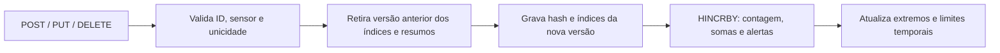

# Otimização Redis — atualização de 19/11/2026

Complemento posterior: [diagnóstico de latência, correções no cliente e propostas de modelagem](DIAGNOSTICO_DESEMPENHO.md). Os ensaios 1M/5M abaixo correspondem à revisão `0d7a74a`; as fontes medidas estão arquivadas em `results/otimizacao/measured-source/`, e a auditoria confere seus hashes mesmo após novas alterações na aplicação.

Esta revisão acrescenta variantes de consulta e mede seu efeito. Os resultados originais de novembro permanecem em `results/benchmark.json` e `results/escala/`; os novos ficam em `results/otimizacao/` e `results/escala/5000000/otimizacao/`. Não compare os tempos de execuções distintas como se fossem pares do mesmo ensaio.

[Tabela das novas medições e interpretação](RESULTADOS_OTIMIZACAO.md).

## O que foi implementado

| Operação | Modelo original, ainda disponível | Nova variante Redis |
|---|---|---|
| Q1: ID | `HGETALL iot:reading:<id>` | Mesmo comando; não houve otimização de Q1 |
| Q2: histórico | Sorted set de IDs, seguido de um `HMGET` por leitura, em Lua | Um `ZRANGE ... BYSCORE LIMIT` em sorted set com os cinco campos completos |
| Q3: resumo | Lua percorre os hashes de todas as leituras selecionadas | Combina resumos diários por sensor; lê os registros exatos das bordas parciais |
| CRUD | Hash, índice temporal e índice de unicidade | Mantém também o índice completo e os agregados, no mesmo script Lua |

Os cinco campos, ordenação, limites inclusivos, filtros por local/sensor, limite do histórico e regra de alerta `temperature_centi > 3200` foram preservados. Não há cache de respostas com TTL no caminho das consultas.

## Critério de comparação justa

1. **Original × original:** PostgreSQL e Redis consultam as mesmas leituras, sem resumos prontos.
2. **Histórico com índices que cobrem a resposta:** PostgreSQL usa o índice existente com `INCLUDE`; Redis usa o novo sorted set completo. Ambos retornam os mesmos cinco campos de 200 leituras, na mesma ordem.
3. **Resumo pré-agregado × pré-agregado:** PostgreSQL lê a view atualizada e Redis lê seus resumos diários. Nenhuma escrita concorrente ocorre durante o ensaio. Os sete campos e filtros são idênticos.

A dashboard separa esses pares e não usa PostgreSQL bruto contra Redis pré-agregado para declarar um vencedor geral. O gráfico também separa as estratégias, com escala própria em cada painel, partindo de zero. O ganho antes/depois do Redis continua documentado como efeito da mudança de modelagem.

A comparação justa é **de custo de leitura nas condições registradas**. O projeto não afirma igualdade de frescor sob escritas concorrentes, custo de manutenção, memória/disco, durabilidade ou disponibilidade. Essas dimensões exigem ensaios próprios. A view SQL não acompanha o CRUD; é atualizada explicitamente antes do benchmark. Os resumos Redis acompanham as escritas da aplicação.

## Estrutura adicional e exemplos

A leitura continua no hash original. O novo sorted set armazena um membro CSV com os cinco inteiros, e usa o timestamp como score:

```text
Chave: iot:opt:v1:sensor:1:full
Score: 1793641200
Membro: 500001,1,1793641200,3059,4573
```

```bash
# Execute no terminal do VS Code, na pasta do repositório.
docker compose exec -T redis redis-cli ZRANGE iot:opt:v1:sensor:501:full -inf +inf BYSCORE LIMIT 0 3
docker compose exec -T redis redis-cli HGETALL iot:opt:v1:sensor:1:day:1793491200
docker compose exec -T redis redis-cli ZRANGE iot:opt:v1:sensor:1:days 0 -1
```

O hash de cada dia contém `count`, `temperature_sum`, `humidity_sum`, `alerts`, `minimum`, `maximum`, `first_ts` e `last_ts`. O índice `:days` contém somente dias com dados, evitando percorrer todos os dias de um intervalo vazio muito longo. O agrupamento usa dias UTC de 86.400 segundos.

Uma consulta de todo o volume pode combinar 4.000 resumos em vez de percorrer 1.000.000 de hashes. No cenário de 5 milhões, há 18.000 resumos. A contagem de sensores inclui apenas sensores com pelo menos uma leitura dentro do filtro; sensores repetidos na lista não são contados duas vezes na variante otimizada.

Se o filtro abranger todas as leituras existentes de um dia, os campos `first_ts` e `last_ts` permitem usar seu agregado mesmo quando esse dia não está preenchido até 23:59:59. Se cobrir apenas parte das leituras, o script usa `ZRANGE` no índice completo para o intervalo exato. Portanto, o resumo das 10.000 leituras entre 00:00 e 00:45 não incorpora dados do restante do dia.

## Como as alterações mantêm o resultado correto



Em uma inserção, `HINCRBY` acumula os contadores, e comparações atualizam mínimo, máximo e limites temporais. Uma atualização primeiro desconta a versão anterior e depois acrescenta a nova, inclusive ao mudar de sensor ou de dia. Uma exclusão remove também o membro completo.

Se a versão retirada era um extremo de temperatura ou de tempo, o script recalcula esses campos usando apenas as leituras restantes daquele sensor/dia. Isso trata mínimos duplicados e remoção do máximo corretamente. Um dia sem registros perde seu hash e sua entrada em `:days`. No gerador atual há até 288 leituras por sensor/dia; essa quantidade não é um limite imposto à API.

As validações de conflito acontecem antes das mudanças. Toda manutenção Redis ocorre na mesma execução Lua, sem intercalar outros comandos da instância. Como antes, Lua não oferece rollback geral em caso de erro de execução/OOM e o desenho é standalone, sem compatibilidade pronta com Redis Cluster. O resumo ainda ocupa a instância durante seu script; reduzir o trabalho não elimina esse comportamento.

## Ativação e reprodução no VS Code

```bash
cd /home/joey/Documentos/GitHub/trabalho-banco-dados
code .
make up
make otimizar-redis
make test-otimizacao
```

No VS Code, **Terminal → Executar tarefa** também oferece as tarefas 7 a 10 para construir índices, testar a otimização, medir as variantes e executar TimeSeries.

`make otimizar-redis` lê os hashes existentes, confere cada leitura com PostgreSQL, grava e relê todos os novos índices e agregados e só então publica o estado `ready`. Não recarrega os bancos nem muda as leituras. Se já estiver pronto, preserva os índices atuais. Use a API atualizada e execute a construção sem outras escritas; a API bloqueia escritas Redis com HTTP 503 enquanto o estado é `building`. Acesso direto via `redis-cli` não obedece a essa proteção.

Uma falha deixa o estado sem ativação. Para recuperar uma construção interrompida, primeiro confirme que o processo anterior terminou e então execute `docker compose exec -T app python -m scripts.optimize_redis --retry`. O comando limpa apenas o namespace de índices em construção. Não use `--retry` enquanto outro construtor estiver rodando. Uma carga nova com `scripts.load --replace` remove também os índices adicionais; execute novamente `make otimizar-redis` depois da carga.

```bash
# Mesmo histórico, duas representações Redis.
curl -s 'http://localhost:8000/api/query?source=redis&operation=history&sensor_id=501&limit=200&redis_mode=baseline'
curl -s 'http://localhost:8000/api/query?source=redis&operation=history&sensor_id=501&limit=200&redis_mode=optimized'

# Resumo das 10 mil leituras; comparação com PostgreSQL.
curl -s 'http://localhost:8000/api/compare?operation=summary&start=1793491200&end=1793493900&redis_mode=optimized'

# Resumo de toda a base principal.
curl -s 'http://localhost:8000/api/compare?operation=summary&redis_mode=optimized'
```

O JSON inclui `strategy`, `elapsed_ms` e `data`; `/api/compare` inclui `results` e `equivalent`. Na dashboard, selecione **Histórico do sensor** ou **Resumo do período**, escolha **Estratégia Redis**, e envie a operação. O console mostra a resposta real. `auto` usa os índices prontos; caso contrário, mantém o modelo original. `optimized` sem índices prontos retorna 503.

```bash
# Novo benchmark: padrão 30 repetições e 5 aquecimentos.
make benchmark-otimizado

# Protocolo executado nesta revisão: 10 repetições e 2 aquecimentos.
docker compose exec -T app python -m scripts.benchmark_optimized --repetitions 10 --warmup 2

# Cenário isolado já carregado de 5 milhões; preserva a base principal.
python3 -m scripts.compare_optimized --records 5000000 --repetitions 10 --warmup 2

# Gerar o gráfico a partir dos JSONs medidos.
make graficos-otimizacao
```

Para reduzir competição de recursos no cenário isolado, pause os serviços principais com `make stop` antes e reabra com `make up` depois. O orquestrador encerra os serviços do cenário isolado ao terminar, mantendo os volumes. `make benchmark` continua reproduzindo o modelo Redis original; a variante nova tem comando e arquivos separados.

## Comparação com PostgreSQL pré-agregado

`scripts.benchmark_optimized` cria/atualiza `readings_daily_experiment`, uma view materializada por sensor/dia, com os mesmos campos agregados. Consulta dias completos na view e bordas parciais na tabela de leituras. O plano real está no novo `plans.json`.

Esse controle evita atribuir todo o ganho à marca do banco: pré-calcular trabalho também beneficia o SQL. A view é atualizada antes do ensaio e não participa da API nem é mantida pelo CRUD. Os agregados Redis são atualizados a cada escrita da aplicação. Portanto, o ensaio compara o custo de leitura com resultados equivalentes em uma base estática; não demonstra equivalência de custo de escrita, frescor, durabilidade ou recuperação. Não use a view experimental após alterar leituras sem executar `REFRESH MATERIALIZED VIEW readings_daily_experiment`.

## RedisTimeSeries: experimento adicional de 10 mil registros

```bash
make timeseries
```

O comando copia as primeiras 10 mil leituras reais para séries temporárias por sensor, com métricas de temperatura, umidade e indicador de alerta. Usa `TS.MRANGE` com agregações nativas `count`, `sum`, `min` e `max`; compara os sete campos do resumo com PostgreSQL; mede 10 repetições após 2 aquecimentos. Também testa alteração com `TS.ADD`, exclusão com `TS.DEL` e compactação horária com `TS.CREATERULE`, incluindo o último bucket com `LATEST`. As chaves temporárias são removidas no final.

Os resultados estão em `results/otimizacao/timeseries.json`. Esse é um protótipo isolado com 10 mil registros, não uma migração da aplicação nem um ensaio TimeSeries com 1M/5M. Ele não implementa o contrato completo de ID, unicidade, mudança de sensor e CRUD da API. Não há `FT.AGGREGATE` neste projeto.

## Custos e limites

- O índice completo duplica os cinco campos para acelerar o histórico. Os hashes e índices originais continuam presentes para permitir comparação. O campo `records` continua contando leituras lógicas; `DBSIZE` inclui todas as estruturas e não representa essa contagem.
- Inclusão, atualização e exclusão fazem mais trabalho para que as leituras de resumo sejam menores. A recomputação de extremos custa proporcionalmente ao dia/sensor afetado.
- Filtros que cortam dias exigem leitura de registros nas bordas. Agregação prévia não garante vantagem em toda consulta; intervalos pequenos podem favorecer PostgreSQL.
- A consulta Q1 usa exatamente o mesmo `HGETALL` nas variantes Redis. Diferenças entre suas amostras são variação de execução, não ganho produzido por esta alteração. A criação de `RedisStore` consulta o estado dos índices com um `GET` adicional; esse passo fica fora do trecho cronometrado dos benchmarks. O impacto no throughput HTTP não foi medido novamente nesta revisão.
- Os testes medem um cliente, cache aquecido, conexões reutilizadas, rede e desserialização, sem HTTP. A ordem das variantes roda a cada repetição. Não são novos testes de concorrência/saturação; os testes HTTP de 1, 4 e 16 clientes continuam históricos.
- O Redis continua com AOF `everysec`, e PostgreSQL com suas configurações próprias de WAL. As garantias de durabilidade não foram igualadas.

## Código para demonstrar na apresentação

1. `RedisStore.history`, em `app/store.py`: compare o caminho original com o `ZRANGE` do índice completo.
2. `SUMMARY_LUA`, em `app/redis_optimized.py`: mostre a decisão entre agregado de dia completo e leitura da borda parcial.
3. `opt_change`, no mesmo arquivo: mostre `HINCRBY` e o tratamento de exclusão de mínimo/máximo.
4. `app/postgres_rollup.py`: explique o controle com view materializada e a necessidade de `REFRESH`.
5. `scripts/benchmark_optimized.py`: mostre rotação da ordem, medição e comparação exata das respostas.

## Fontes primárias

- [Redis — ZRANGE](https://redis.io/docs/latest/commands/zrange/): consultas por score e limite.
- [Redis — HINCRBY](https://redis.io/docs/latest/commands/hincrby/): incremento inteiro em hash.
- [Redis — TS.MRANGE](https://redis.io/docs/latest/commands/ts.mrange/): consultas e agregações de séries por filtros.
- [Redis — TS.CREATERULE](https://redis.io/docs/latest/commands/ts.createrule/): regras de compactação.
- [Redis — TS.DEL](https://redis.io/docs/latest/commands/ts.del/): exclusão por intervalo.
- [PostgreSQL 17 — Materialized views](https://www.postgresql.org/docs/17/rules-materializedviews.html): resultados persistidos e atualização explícita.
