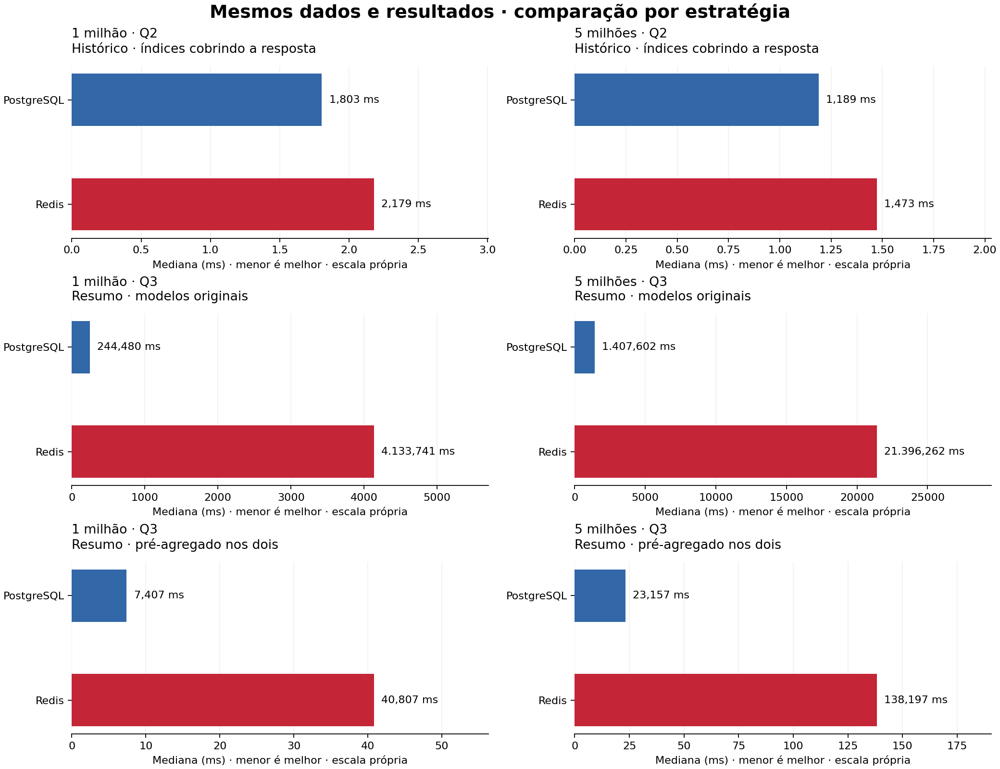

# Novos resultados — otimização Redis (19/11/2026)

Medições com um cliente, cache aquecido, 10 repetições e 2 aquecimentos por variante/operação. Tempos de cliente, incluindo execução, rede e desserialização, sem abertura da conexão e sem HTTP. A ordem das variantes foi rotacionada. Todos os resultados foram comparados campo a campo.

| Massa | Consulta | PostgreSQL bruto (ms) | Redis original (ms) | Redis otimizado (ms) | PostgreSQL pré-agregado (ms) |
|---|---|---:|---:|---:|---:|
| 1,000,000 | Q1 | 1.011 | 0.524 | 0.456 | — |
| 1,000,000 | Q2 | 1.803 | 7.084 | 2.179 | — |
| 1,000,000 | Q3 | 244.480 | 4133.741 | 40.807 | 7.407 |
| 5,000,000 | Q1 | 0.580 | 0.421 | 0.399 | — |
| 5,000,000 | Q2 | 1.189 | 4.490 | 1.473 | — |
| 5,000,000 | Q3 | 1407.602 | 21396.262 | 138.197 | 23.157 |

Q1 mantém o mesmo `HGETALL`; a diferença entre variantes é variação de medição. Q2 retorna as primeiras 200 leituras de um sensor. Q3 resume todos os registros do cenário.

## Como interpretar

- **1,000,000 leituras:** Q2 Redis melhorou 3.25×; Q3 melhorou 101.30× frente ao Redis original. A construção conferiu todos os registros e 4,000 resumos; levou 74.66 s. Aumento observado de `used_memory`: 93.71 MiB. Preparação da view SQL: 0.48 s.
- **5,000,000 leituras:** Q2 Redis melhorou 3.05×; Q3 melhorou 154.82× frente ao Redis original. A construção conferiu todos os registros e 18,000 resumos; levou 339.36 s. Aumento observado de `used_memory`: 489.98 MiB. Preparação da view SQL: 0.99 s.

O PostgreSQL bruto venceu Q2 neste ensaio; o Redis otimizado reduziu seu custo, sem garantia de ultrapassar SQL. Em Q3, Redis otimizado venceu o SQL bruto, mas PostgreSQL pré-agregado foi mais rápido. A comparação pré-agregada é de leitura: Redis mantém seus resumos a cada CRUD; a view SQL usa atualização prévia. Não são garantias gerais de superioridade, capacidade máxima ou mesma durabilidade.

## Experimento TimeSeries

Prova separada com **10.000 leituras**: postgres_raw: 8.809 ms, redis_optimized: 43.277 ms, redis_timeseries: 96.988 ms. Agregação, alteração, exclusão e compactação conferidas; todas as chaves temporárias removidas. TimeSeries não superou as outras estratégias neste protótipo. Não foi integrado à API nem testado com 1M/5M.

Estrutura, scripts, comandos e limites: [guia da otimização](OTIMIZACAO_REDIS.md).
