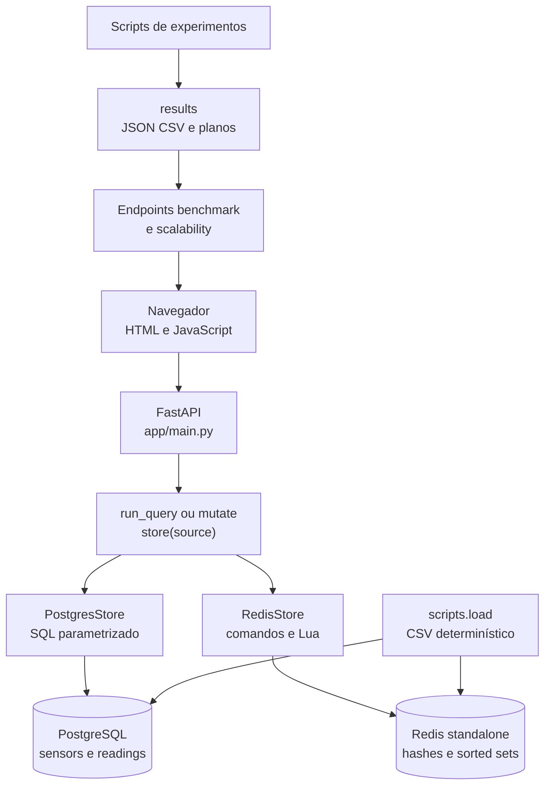
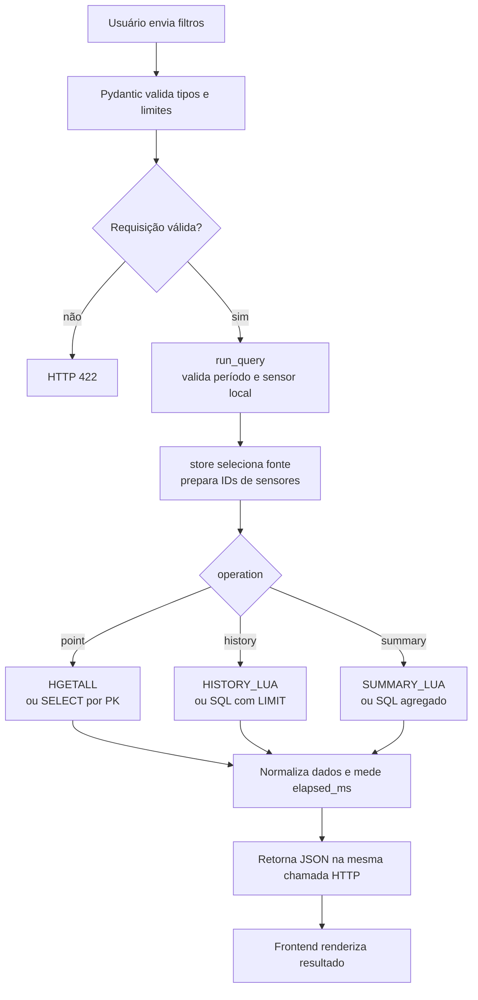
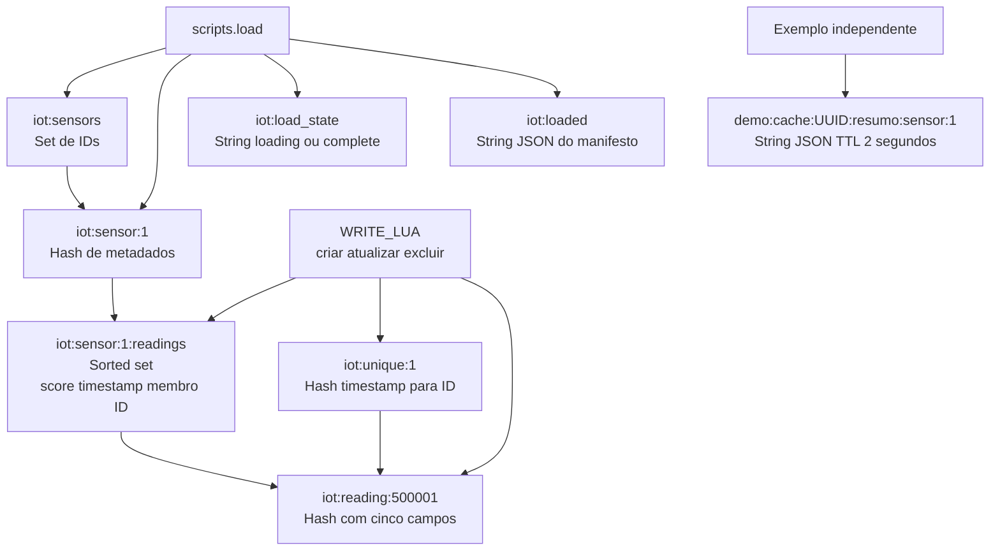
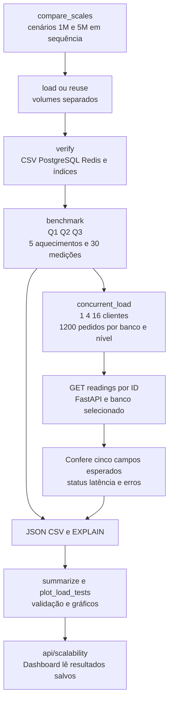
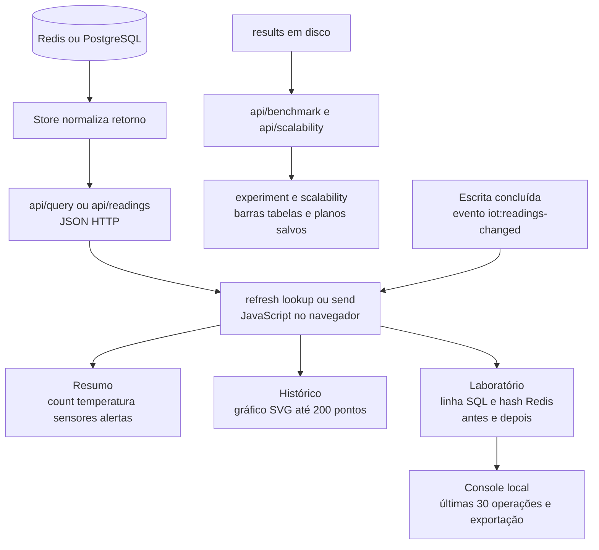

# Engenharia reversa do Observatório IoT

Redis e PostgreSQL na implementação de consultas e na Dashboard

Data da investigação: 18 de novembro de 2026. Commit de base: e7ae3267a2957c8f83a78f00efc086267be3ac03, com correções documentais e do carregador em 18/11/2026. Os hashes da versão analisada constam no manifesto de fontes.

Este documento permite localizar a implementação de cada consulta, acompanhar os dados entre navegador, API e bancos e interpretar os testes registrados. A aplicação compara duas cópias da telemetria ambiental. Redis armazena uma cópia completa em hashes e índices próprios; PostgreSQL usa tabelas e índices relacionais. As consultas são executadas dentro da requisição HTTP, sem um agendador de buscas ou fila persistida.

O mecanismo principal não consulta um cache de respostas. O exemplo com TTL é um programa didático independente. Os indicadores ao vivo e os relatórios de desempenho seguem fluxos diferentes, descritos nas seções seguintes.

## 1 Escopo e evidências da investigação

Foram lidos os módulos de aplicação, scripts de carga e medição, frontend, esquema SQL, configuração Docker, exemplos e testes. Cada trecho de código abaixo foi extraído dos arquivos existentes. As referências incluem caminho absoluto e linha inicial; números de linha correspondem à revisão indicada na abertura. Exemplos calculados pelo gerador são identificados como saídas esperadas; resultados de ensaios vêm dos JSONs e CSVs registrados.

Na revisão de 18/11/2026, os serviços foram iniciados, os testes funcionais foram repetidos e a base principal passou por nova verificação integral. A contagem real foi de 1.000.000 de leituras por banco. O catálogo SQL e os tipos dos parâmetros psycopg foram consultados diretamente. Uma carga independente de 1.001 leituras validou a publicação completa do manifesto, sem substituir a massa principal. As medições de desempenho de 1M e 5M são históricas e permanecem com suas datas e valores originais. Evidências atuais: results/documentation_validation.json, results/verification.json e results/validacao_carga_documentacao.json.

Mapa de leitura: seções 2–6 explicam arquitetura, consultas e planejamento; 7–9 detalham chaves, gravações e exemplos; 10–12 cobrem medições, planos e testes; 13–14 descrevem a Dashboard e a reprodução; 15–16 registram correções e melhorias; 18 relaciona o documento aos requisitos acadêmicos. Os cinco diagramas Mermaid têm os arquivos de origem em docs/engenharia/diagramas/.

## 2 Arquitetura e responsabilidade de cada camada

| Camada | Implementação | Responsabilidade |
|---|---|---|
| Navegador | web/index.html; app.js; operations.js | Filtros, formulários, requisições HTTP, gráficos e console local |
| API | app/main.py | Contratos Pydantic, seleção da fonte, execução das operações e HTTP JSON |
| Acesso relacional | app/store.py — PostgresStore | SQL parametrizado em sensors e readings |
| Acesso Redis | app/store.py — RedisStore | Comandos diretos, pipelines e três scripts Lua |
| Dados iniciais | scripts/load.py; sql/schema.sql | CSV determinístico e duas cargas independentes |
| Experimentos | scripts/benchmark.py; concurrent_load.py; compare_scales.py | Amostras, comparação de retornos e cenários Docker |
| Evidências | results/; output/graficos/ | Arquivos medidos e gráficos derivados, servidos em endpoints de leitura |

Entradas principais: [/home/joey/Documentos/GitHub/trabalho-banco-dados/app/main.py — linhas 13 a 24](/home/joey/Documentos/GitHub/trabalho-banco-dados/app/main.py:13); [/home/joey/Documentos/GitHub/trabalho-banco-dados/app/store.py — linhas 235 a 244](/home/joey/Documentos/GitHub/trabalho-banco-dados/app/store.py:235); [/home/joey/Documentos/GitHub/trabalho-banco-dados/web/index.html — linhas 6 a 11](/home/joey/Documentos/GitHub/trabalho-banco-dados/web/index.html:6). O frontend é HTML/CSS/JavaScript, sem componentes React ou serviço de buscas separado. Não há Celery, RQ, worker de fila, serviço externo de execução ou módulo RediSearch na implementação analisada. O único worker configurado é o processo Uvicorn; esse termo não designa um consumidor de tarefas Redis.

O Dockerfile executa Uvicorn com --workers 1 e porta interna 8000. As rotas são funções def síncronas: a infraestrutura ASGI pode atendê-las em threads, mas a aplicação não controla um escalonador próprio ou estabelece prioridades. Cada chamada store(source) abre o contexto da fonte escolhida. PostgreSQL cria uma conexão psycopg por contexto; o código não define um pool compartilhado da aplicação. Redis.from_url cria um cliente com seu mecanismo de conexão, também por contexto; não existe cliente singleton compartilhado no código.

[/home/joey/Documentos/GitHub/trabalho-banco-dados/Dockerfile](/home/joey/Documentos/GitHub/trabalho-banco-dados/Dockerfile); [/home/joey/Documentos/GitHub/trabalho-banco-dados/app/store.py — linhas 23 a 28](/home/joey/Documentos/GitHub/trabalho-banco-dados/app/store.py:23).

compose.yaml publica app em 127.0.0.1:8000, PostgreSQL em 127.0.0.1:55432 e Redis em 127.0.0.1:56379. Na rede Docker, os nomes são postgres:5432 e redis:6379/0. Os bancos usam volumes nomeados distintos. compose.escala.yaml cria projetos iot-escala-1000000 e iot-escala-5000000, sem portas publicadas, com pastas de dados e resultados independentes.

[/home/joey/Documentos/GitHub/trabalho-banco-dados/compose.yaml](/home/joey/Documentos/GitHub/trabalho-banco-dados/compose.yaml); [/home/joey/Documentos/GitHub/trabalho-banco-dados/compose.escala.yaml](/home/joey/Documentos/GitHub/trabalho-banco-dados/compose.escala.yaml); [/home/joey/Documentos/GitHub/trabalho-banco-dados/scripts/compare_scales.py — linhas 17 a 30](/home/joey/Documentos/GitHub/trabalho-banco-dados/scripts/compare_scales.py:17).

### Arquitetura geral



Origem editável: [/home/joey/Documentos/GitHub/trabalho-banco-dados/docs/engenharia/diagramas/01_arquitetura.mmd](/home/joey/Documentos/GitHub/trabalho-banco-dados/docs/engenharia/diagramas/01_arquitetura.mmd).

## 3 Contrato lógico e entradas HTTP

Uma leitura tem cinco inteiros: id, sensor_id, ts, temperature_centi e humidity_centi. ts é epoch UTC em segundos; temperatura e umidade são centésimos. O alerta é estritamente temperature_centi > 3200, ou seja, acima de 32,00 °C. A função normalized converte os textos do hash Redis em inteiros para manter o mesmo JSON lógico do PostgreSQL. canonical serializa os campos na ordem fixa para comparar CSV e bancos.

[/home/joey/Documentos/GitHub/trabalho-banco-dados/app/store.py — linhas 11 a 17](/home/joey/Documentos/GitHub/trabalho-banco-dados/app/store.py:11)

```python
FIELDS = ("id", "sensor_id", "ts", "temperature_centi", "humidity_centi")
MAX_READING_ID = 9_000_000_000_000_000
MAX_SENSOR_ID = 2_147_483_647
MAX_TIMESTAMP = 253_402_300_799  # 9999-12-31 23:59:59 UTC; exato em sorted sets.
BOUNDS = {"id": (1, MAX_READING_ID), "sensor_id": (1, MAX_SENSOR_ID),
          "ts": (1, MAX_TIMESTAMP), "temperature_centi": (-5000, 10000),
          "humidity_centi": (0, 10000)}
```

[/home/joey/Documentos/GitHub/trabalho-banco-dados/app/store.py — linhas 31 a 36](/home/joey/Documentos/GitHub/trabalho-banco-dados/app/store.py:31)

```python
def normalized(row):
    return {k: int(row[k]) for k in FIELDS} if row else None


def canonical(row):
    return ",".join(str(int(row[k])) for k in FIELDS) + "\n"
```

Reading, em [/home/joey/Documentos/GitHub/trabalho-banco-dados/app/main.py — linhas 19 a 24](/home/joey/Documentos/GitHub/trabalho-banco-dados/app/main.py:19), valida o corpo das gravações. Source aceita postgres ou redis e Operation aceita point, history ou summary. O frontend tem limites próprios e transforma graus em centésimos antes de enviar; a API usa Pydantic sem strict=True, portanto o contrato de coerção da camada HTTP difere da checagem type(value) is int usada diretamente por validate_reading. Nenhuma dessas rotas aceita SQL arbitrário ou comandos Redis arbitrários.

| Entrada de /api/query | Padrão e limites | Aplicação efetiva |
|---|---|---|
| source | postgres; postgres ou redis | Escolhe Store |
| operation | summary; point history summary | Escolhe operação |
| reading_id | 1; 1 a 9×10¹⁵ | Usado em point |
| sensor_id | Opcional; 1 a 2147483647 | Obrigatório em history; seleciona um sensor em summary |
| start e end | 1 e 4102444800; até 253402300799 | Período inclusivo; end deve ser >= start |
| limit | 200; 1 a 1000 | Somente history |
| location | Texto opcional | Filtra sensores para summary e valida combinação sensor/local |

Referência: [/home/joey/Documentos/GitHub/trabalho-banco-dados/app/main.py — linhas 50 a 84](/home/joey/Documentos/GitHub/trabalho-banco-dados/app/main.py:50). run_query calcula os IDs de sensores antes de selecionar a operação; em point eles não restringem o ID consultado. Um sensor e local incompatíveis são rejeitados mesmo se a operação for point. Sem local, um sensor inexistente em history devolve lista vazia; não há consulta de existência do sensor nessa rota. O GET /api/query com point inexistente devolve data=null com HTTP 200; GET /api/readings/{id} devolve HTTP 404. Essa diferença é intencional no contrato observado e importa para a tela de comparação.

| Endpoint | Função | Origem do retorno |
|---|---|---|
| GET /api/health | health | SELECT 1 e PING; 503 se indisponível |
| GET /api/meta?source=... | meta | Sensores da fonte e results/load.json do disco |
| GET /api/query | query → run_query | Consulta ao banco escolhido |
| GET /api/compare | compare | run_query PostgreSQL e depois Redis; compara data |
| GET /api/readings/{id} | read_reading | Busca por ID com 404 para ausência |
| POST /api/readings?source=... | create_reading → mutate | Insere, retorna a leitura e HTTP 201 |
| PUT /api/readings/{id}?source=... | update_reading → mutate | Substitui os campos; corpo.id deve coincidir com rota |
| DELETE /api/readings/{id}?source=... | delete_reading → mutate | Remove e retorna a versão excluída |
| GET /api/benchmark | benchmark | results/benchmark.json; não executa benchmark |
| GET /api/scalability | scalability | results/escala/comparacao.json; não inicia carga |
| GET /api/scalability/{records}/plans | scalability_plans | plans.txt salvo; records restrito a 1000000 ou 5000000 |
| GET / e /static/* | index e StaticFiles | HTML, CSS e JavaScript |

Mapa de rotas: [/home/joey/Documentos/GitHub/trabalho-banco-dados/app/main.py — linhas 27 a 158](/home/joey/Documentos/GitHub/trabalho-banco-dados/app/main.py:27). /docs e /openapi.json são disponibilizados pela configuração padrão FastAPI. Não foi encontrado endpoint para enfileirar buscas, consultar tarefas ou iniciar experimentos pela Dashboard.

## 4 Estratégias de consulta implementadas

As estratégias abaixo são caminhos explícitos de acesso. A classe RedisStore não avalia alternativas por custo ou seleciona índices automaticamente. PostgresStore envia SQL; o planejador relacional escolhe a execução no servidor. A listagem de sensores auxilia a preparação de filtros e também é uma consulta real.

### 4 1 Listagem e filtro de sensores

Objetivo: carregar os metadados usados nos seletores e transformar um local em IDs para o resumo. Entrada: location=None ou o nome de um local. PostgreSQL executa SELECT * FROM sensors WHERE (%s::text IS NULL OR location=%s) ORDER BY id. Redis lê todos os IDs de iot:sensors, converte-os para inteiros e os ordena em Python; usa um pipeline sem transação para HGETALL de cada sensor e filtra location depois de receber todos os hashes.

[/home/joey/Documentos/GitHub/trabalho-banco-dados/app/store.py — linhas 191 a 198](/home/joey/Documentos/GitHub/trabalho-banco-dados/app/store.py:191)

```python
    def sensors(self, location=None):
        ids = sorted(map(int, self.conn.smembers("iot:sensors")))
        with self.conn.pipeline(transaction=False) as p:
            for sid in ids:
                p.hgetall(f"iot:sensor:{sid}")
            rows = p.execute()
        return [dict(id=int(r["id"]), name=r["name"], location=r["location"], active=r["active"] == "1")
                for r in rows if location is None or r["location"] == location]
```

O resultado contém id inteiro, name e location textuais e active booleano. A seleção não exclui sensores inactive; active é metadado retornado. A vantagem do pipeline é reduzir idas e voltas na rede; ele não torna a sequência uma transação atômica. O custo Redis cresce com o total de sensores, mesmo quando um único local é solicitado. Não há Set por local nem Sorted Set de prioridades. Um hash de metadados ausente pode provocar erro de acesso a campos. Essa estratégia é chamada em /api/meta e em run_query quando nenhum sensor foi especificado.

Referências adicionais: [/home/joey/Documentos/GitHub/trabalho-banco-dados/app/store.py — linhas 62 a 65](/home/joey/Documentos/GitHub/trabalho-banco-dados/app/store.py:62); [/home/joey/Documentos/GitHub/trabalho-banco-dados/app/main.py — linhas 38 a 57](/home/joey/Documentos/GitHub/trabalho-banco-dados/app/main.py:38).

### 4 2 Q1 Leitura pelo identificador

Objetivo: recuperar uma medição conhecida, por exemplo o ID 500001. Entrada do Store: reading_id inteiro. A API já limita a faixa numérica. PostgreSQL executa WHERE id=%s e retorna uma linha ou None. Redis constrói exatamente uma chave iot:reading:{reading_id}, executa HGETALL e converte os cinco campos usando normalized.

[/home/joey/Documentos/GitHub/trabalho-banco-dados/app/store.py — linhas 67 a 68](/home/joey/Documentos/GitHub/trabalho-banco-dados/app/store.py:67)

```python
    def point(self, reading_id):
        return self.conn.execute("SELECT * FROM readings WHERE id=%s", (reading_id,)).fetchone()
```

[/home/joey/Documentos/GitHub/trabalho-banco-dados/app/store.py — linhas 200 a 201](/home/joey/Documentos/GitHub/trabalho-banco-dados/app/store.py:200)

```python
    def point(self, reading_id):
        return normalized(self.conn.hgetall(f"iot:reading:{reading_id}"))
```

Fluxo completo: formulário → GET /api/readings ou /api/query → validação → store(source) → point → banco → dicionário/None → JSON → lookup ou renderReadingPair. Não há leitura de cache nem escrita de resultado após a busca. O hash já é o dado persistido. Uma chamada repetida faz novamente a consulta.

HGETALL tem custo proporcional ao tamanho do hash; são cinco campos nesta modelagem. A quantidade total de leituras não implica percorrer todos os hashes. No PostgreSQL, o plano capturado usa readings_pkey; detalhes do plano aparecem na seção 11. Gargalos possíveis: abertura de conexões, rede, materialização da resposta e disputa com scripts Lua longos. O endpoint de carga HTTP usa /api/readings, que evita a seleção preliminar de sensores realizada em /api/query.

Referências do caminho: [/home/joey/Documentos/GitHub/trabalho-banco-dados/app/main.py — linhas 50 a 68](/home/joey/Documentos/GitHub/trabalho-banco-dados/app/main.py:50); [/home/joey/Documentos/GitHub/trabalho-banco-dados/app/main.py — linhas 134 a 140](/home/joey/Documentos/GitHub/trabalho-banco-dados/app/main.py:134); [/home/joey/Documentos/GitHub/trabalho-banco-dados/web/app.js — linhas 70 a 96](/home/joey/Documentos/GitHub/trabalho-banco-dados/web/app.js:70).

### 4 3 Q2 Histórico de um sensor por período

Objetivo: obter as primeiras leituras cronológicas de um sensor no intervalo inclusivo [start,end]. Entradas: sensor_id, start, end e limit, padrão 200 no Store e na API, limite HTTP máximo 1000. PostgreSQL filtra por sensor e instante, ordena por ts,id e usa LIMIT parametrizado.

[/home/joey/Documentos/GitHub/trabalho-banco-dados/app/store.py — linhas 70 a 75](/home/joey/Documentos/GitHub/trabalho-banco-dados/app/store.py:70)

```python
    def history(self, sensor_id, start, end, limit=200):
        # Limites inclusivos, ordem crescente e mesmo LIMIT nos dois SGBDs.
        return self.conn.execute(
            "SELECT * FROM readings WHERE sensor_id=%s AND ts BETWEEN %s AND %s ORDER BY ts,id LIMIT %s",
            (sensor_id, start, end, limit),
        ).fetchall()
```

RedisStore.history chama HISTORY_LUA com uma única chave de Sorted Set e argumentos de tempo e limite. O script seleciona IDs por score e lê os cinco campos de cada hash com HMGET. Python transforma cada lista em dicionário de inteiros.

[/home/joey/Documentos/GitHub/trabalho-banco-dados/app/store.py — linhas 124 a 132](/home/joey/Documentos/GitHub/trabalho-banco-dados/app/store.py:124)

```lua
HISTORY_LUA = """
local ids = redis.call('ZRANGEBYSCORE', KEYS[1], ARGV[1], ARGV[2], 'LIMIT', 0, ARGV[3])
local rows = {}
for _, id in ipairs(ids) do
  local r = redis.call('HMGET', 'iot:reading:' .. id, 'id','sensor_id','ts','temperature_centi','humidity_centi')
  rows[#rows+1] = r
end
return rows
"""
```

[/home/joey/Documentos/GitHub/trabalho-banco-dados/app/store.py — linhas 203 a 205](/home/joey/Documentos/GitHub/trabalho-banco-dados/app/store.py:203)

```python
    def history(self, sensor_id, start, end, limit=200):
        rows = self._history(keys=[f"iot:sensor:{sensor_id}:readings"], args=[start, end, limit])
        return [dict(zip(FIELDS, map(int, row))) for row in rows]
```

A lógica está na string Lua de um módulo Python; o trecho foi extraído literalmente, incluindo o delimitador da string. O Sorted Set usa score=ts e membro=ID da leitura. Limites inclusivos e LIMIT 0 limit reduzem o trabalho quando o período tem muitas leituras. A unicidade sensor/instante mantida pelo projeto elimina empates de score para um sensor; sem essa integridade, desempates lexicográficos de membros Redis poderiam diferir da ordem numérica ts,id do SQL.

Fluxo: refresh escolhe um sensor → /api/query?operation=history → run_query exige sensor → history → HISTORY_LUA → ZRANGEBYSCORE → HMGET de cada ID → retorno do script → objetos → chart. O frontend de visão geral solicita até 200; o laboratório aceita até 1000.

Custo do comando de faixa: O(log N + M), com N membros do índice do sensor e M retornos. Soma-se a reconstrução dos M hashes e o tamanho da resposta. O script é atômico em relação a outras operações Redis e ocupa a execução até terminar. Não há paginação por cursor: ampliar limit é a única opção implementada. Índices inconsistentes, hashes ausentes ou campos inválidos podem produzir erro, pois não há reparo no caminho de leitura.

### 4 4 Q3 Resumo de sensores e período

Objetivo: contar leituras e sensores com dados, somar temperatura/umidade, contar alertas, obter mínimo e máximo. Entradas do Store: lista sensor_ids, start e end. A API usa o sensor informado ou os IDs de s.sensors(location). A seleção de sensores fica fora do cronômetro do backend. No SQL, sensor_id=ANY(%s) e ts BETWEEN restringem os dados; count(DISTINCT sensor_id) conta apenas sensores com leituras. COALESCE devolve somas zero em conjuntos vazios; min/max ficam None.

[/home/joey/Documentos/GitHub/trabalho-banco-dados/app/store.py — linhas 77 a 87](/home/joey/Documentos/GitHub/trabalho-banco-dados/app/store.py:77)

```python
    def summary(self, sensor_ids, start, end):
        row = self.conn.execute(
            """SELECT count(*) AS count, count(DISTINCT sensor_id) AS sensors,
               COALESCE(sum(temperature_centi),0) AS temperature_sum,
               COALESCE(sum(humidity_centi),0) AS humidity_sum,
               count(*) FILTER (WHERE temperature_centi > 3200) AS alerts,
               min(temperature_centi) AS minimum, max(temperature_centi) AS maximum
               FROM readings WHERE sensor_id=ANY(%s) AND ts BETWEEN %s AND %s""",
            (sensor_ids, start, end),
        ).fetchone()
        return {k: int(v) if v is not None else None for k, v in row.items()}
```

[/home/joey/Documentos/GitHub/trabalho-banco-dados/app/store.py — linhas 134 a 150](/home/joey/Documentos/GitHub/trabalho-banco-dados/app/store.py:134)

```lua
SUMMARY_LUA = """
local count, sensors, tsum, hsum, alerts, minv, maxv = 0,0,0,0,0,nil,nil
for _, key in ipairs(KEYS) do
  local ids = redis.call('ZRANGEBYSCORE', key, ARGV[1], ARGV[2])
  if #ids > 0 then sensors = sensors + 1 end
  for _, id in ipairs(ids) do
    local v = redis.call('HMGET','iot:reading:'..id,'temperature_centi','humidity_centi')
    local t, h = tonumber(v[1]), tonumber(v[2])
    count = count + 1
    tsum = tsum + t
    hsum = hsum + h
    if t > 3200 then alerts = alerts + 1 end
    if minv == nil or t < minv then minv = t end
    if maxv == nil or t > maxv then maxv = t end
  end
end
return {count,sensors,tsum,hsum,alerts,minv or false,maxv or false}
```

[/home/joey/Documentos/GitHub/trabalho-banco-dados/app/store.py — linhas 207 a 210](/home/joey/Documentos/GitHub/trabalho-banco-dados/app/store.py:207)

```python
    def summary(self, sensor_ids, start, end):
        values = self._summary(keys=[f"iot:sensor:{sid}:readings" for sid in sensor_ids], args=[start, end])
        keys = ("count", "sensors", "temperature_sum", "humidity_sum", "alerts", "minimum", "maximum")
        return dict(zip(keys, [int(v) if v is not None else None for v in values]))
```

No Redis, para cada índice temporal selecionado, SUMMARY_LUA recupera todos os IDs do período sem LIMIT. Em seguida lê dois campos de cada hash, converte-os em números e acumula sete métricas. minv or false e maxv or false representam ausência, convertida pelo cliente em None. Um sensor com IDs no índice conta como sensor com leituras. Não há JOIN, resumo pré-computado nem cache do resultado. O código pressupõe integridade dos hashes referenciados.

Fluxo: filtros de Dashboard → Promise.all de resumo e histórico → /api/query → run_query → summary → Lua/SQL → data com sete campos → refresh calcula média temperature_sum/count/100 e percentual de alertas. A umidade é somada no retorno, embora o painel principal não tenha um cartão de média de umidade.

O esforço cresce com todos os registros selecionados. A execução de Q3 sobre 5M percorre cinco milhões de hashes no modelo Redis; o Sorted Set só determina quais IDs ler. O script Lua longo bloqueia o processamento de outras operações Redis durante sua execução, podendo elevar a latência de consultas por ID de outros clientes. Esse bloqueio sob mistura de cargas não foi medido pelo teste HTTP existente.

## 5 Preparação das buscas e controle de execução

O planejamento da aplicação consiste em escolher fonte e operação, validar filtros, montar a lista de sensores e enviar um caminho de comandos conhecido. Não há fase que grava uma descrição de busca pendente em Redis. A função run_query inicia e termina na mesma chamada HTTP, e o Redis participa como base consultada ou como executor dos scripts Lua.

[/home/joey/Documentos/GitHub/trabalho-banco-dados/app/main.py — linhas 50 a 68](/home/joey/Documentos/GitHub/trabalho-banco-dados/app/main.py:50)

```python
def run_query(source, operation, reading_id, sensor_id, start, end, limit, location):
    if end < start:
        raise HTTPException(422, "Fim deve ser maior ou igual ao início")
    with store(source) as s:
        # Conexão e seleção de sensores fora do trecho cronometrado em ambas as fontes.
        ids = [sensor_id] if sensor_id else [row["id"] for row in s.sensors(location)]
        if sensor_id and location and sensor_id not in [row["id"] for row in s.sensors(location)]:
            raise HTTPException(422, "Sensor não pertence ao local selecionado")
        if operation == "history" and not sensor_id:
            raise HTTPException(422, "Selecione um sensor para consultar o histórico")
        t = time.perf_counter_ns()
        if operation == "point":
            result = s.point(reading_id)
        elif operation == "history":
            result = s.history(sensor_id, start, end, limit)
        else:
            result = s.summary(ids, start, end)
        elapsed = (time.perf_counter_ns() - t) / 1e6
    return {"source": source, "operation": operation, "elapsed_ms": elapsed, "data": result}
```

| Mecanismo solicitado | Situação confirmada | Evidência |
|---|---|---|
| Prioridade por busca | Ausente; timestamp do Sorted Set ordena medições | RedisStore.history e SUMMARY_LUA |
| Pendente executando concluída no Redis | Ausente para consultas | Não há chaves ou comandos correspondentes em app/ |
| Fila e consumidor | Ausentes | Rotas def chamam Stores diretamente |
| Identificador de job | Ausente | Retorno só source operation elapsed_ms data |
| Resultados anteriores | Nova consulta a cada pedido | point/history/summary sem GET/SET de cache |
| Deduplicação de buscas | Ausente | Requisições iguais executam novamente |
| Duplicação de medições | Impedida por ID e sensor/ts | WRITE_LUA e UNIQUE SQL |
| Expiração das consultas | Ausente | Nenhuma chave de consulta ou TTL no fluxo principal |
| Novas tentativas de negócio | Ausentes | Sem laço retry ou backoff da aplicação |
| Seleção de quando executar | Ao receber a chamada HTTP | run_query executa imediatamente após validar |
| Estado visível no navegador | Implementado em memória da aba | running, entries, AbortController e mensagens DOM |

### Concorrência e atomicidade

HISTORY_LUA, SUMMARY_LUA e WRITE_LUA executam como scripts Redis; a atomicidade significa que outras operações não se intercalam com os comandos do script. Não equivale a rollback geral se um comando falha após gravações anteriores. O código valida existência, sensor e conflito antes das alterações de WRITE_LUA, mas não implementa reversão para erros Redis inesperados, tipos de chave incorretos ou exaustão de memória.

PostgreSQL mantém suas restrições e a transação no contexto da conexão; saída bem-sucedida confirma as alterações e erro provoca rollback pelo contexto psycopg. Atualizações não usam coluna version nem condição de valor anterior. No Redis também não há WATCH, compare-and-swap ou lock de edição: duas atualizações válidas podem resultar na última gravação prevalecendo. A verificação de unicidade e a mudança de índices, entretanto, ocorrem juntas dentro do script. Referências: [/home/joey/Documentos/GitHub/trabalho-banco-dados/app/store.py — linhas 155 a 180](/home/joey/Documentos/GitHub/trabalho-banco-dados/app/store.py:155); [/home/joey/Documentos/GitHub/trabalho-banco-dados/app/store.py — linhas 89 a 121](/home/joey/Documentos/GitHub/trabalho-banco-dados/app/store.py:89); [/home/joey/Documentos/GitHub/trabalho-banco-dados/app/store.py — linhas 235 a 242](/home/joey/Documentos/GitHub/trabalho-banco-dados/app/store.py:235).

O botão desabilitado por running impede nova operação no módulo do laboratório daquela aba. Não coordena outras abas, os botões da visão geral, scripts CLI ou outros clientes. AbortController em refresh cancela o fetch anterior do navegador; não há comando de cancelamento ao Redis nem garantia de parar um Lua já iniciado. O backend não consulta iot:load_state para impedir leitura durante uma carga.

### Erros e repetição

Conflict, Missing e Invalid são traduzidas em 409, 404 e 422 por mutate. Erros de validação das rotas geram 422; /api/health e /api/meta capturam exceções e retornam 503. Erros não tratados de conexão, WRONGTYPE ou conversão podem chegar como 500 nas rotas de consulta/gravação. Não existe estado de falha persistido por busca. O console mantém a resposta e apresenta errorHint; em uma falha de rede após escrita, o cliente não prova se a operação ocorreu. Ele orienta consultar antes de repetir.

register_script registra objetos de script no cliente redis-py. A manutenção do cache de scripts e eventual recarga após NOSCRIPT pertencem à biblioteca; isso não constitui agendamento ou retry de negócio implementado neste projeto. As conexões principais não configuram socket_timeout nem backoff explícito; os exemplos didáticos usam timeouts de cinco segundos e o gerador HTTP usa timeout de trinta segundos.

Referências: [/home/joey/Documentos/GitHub/trabalho-banco-dados/app/main.py — linhas 111 a 126](/home/joey/Documentos/GitHub/trabalho-banco-dados/app/main.py:111); [/home/joey/Documentos/GitHub/trabalho-banco-dados/app/store.py — linhas 184 a 189](/home/joey/Documentos/GitHub/trabalho-banco-dados/app/store.py:184); [/home/joey/Documentos/GitHub/trabalho-banco-dados/web/operations.js — linhas 71 a 86](/home/joey/Documentos/GitHub/trabalho-banco-dados/web/operations.js:71); [/home/joey/Documentos/GitHub/trabalho-banco-dados/web/operations-core.mjs — linhas 95 a 97](/home/joey/Documentos/GitHub/trabalho-banco-dados/web/operations-core.mjs:95); [/home/joey/Documentos/GitHub/trabalho-banco-dados/exemplos/redis/_conexao.py — linhas 7 a 13](/home/joey/Documentos/GitHub/trabalho-banco-dados/exemplos/redis/_conexao.py:7).

### Fluxo de seleção e execução



Origem editável: [/home/joey/Documentos/GitHub/trabalho-banco-dados/docs/engenharia/diagramas/02_execucao.mmd](/home/joey/Documentos/GitHub/trabalho-banco-dados/docs/engenharia/diagramas/02_execucao.mmd).

## 6 Plano operacional de cada caminho de leitura

| Etapa | Sensores | Q1 | Q2 | Q3 |
|---|---|---|---|---|
| Entrada | location | reading_id | sensor_id start end limit | sensor_ids start end |
| Preparação | Lista e filtro | Chave ou bind ID | Chave temporal ou binds SQL | Lista de índices ou ANY SQL |
| Redis | SMEMBERS e pipeline HGETALL | HGETALL | Lua faixa e HMGET | Lua faixa e agregação |
| Cache de resultado | Não consulta | Não consulta | Não consulta | Não consulta |
| Saída | Lista de sensores | Objeto ou None | Lista ordenada | Sete métricas |
| Persistência de resultado | Nenhuma | Nenhuma | Nenhuma | Nenhuma |
| Dashboard | Opções e filtros | Cartões e comparação | Histórico e console | Indicadores e console |

Cada caminho tem o mesmo encerramento: Store retorna → run_query calcula elapsed_ms → fecha o contexto da conexão → serializa JSON → JavaScript renderiza. Na rota direta GET /api/readings/{id}, não há elapsed_ms no corpo; o laboratório mede o tempo HTTP no navegador. Não há atualização de job status no banco em nenhuma dessas etapas. Os arquivos de benchmark são produzidos por scripts CLI, não pela chamada comum de consulta.

No PostgreSQL, a árvore real do plano não é codificada no Store. O uso de índices é decisão do servidor com base em consulta, estatísticas e catálogo. No Redis, os comandos e a ordem constam literalmente dos scripts; chamar esse rastreamento de plano operacional ajuda a explicar o código, mas não implica um otimizador SQL do Redis.

## 7 Catálogo completo das estruturas Redis

Namespace principal iot:, banco lógico 0 e cliente decode_responses=True. Prefixos demo: ficam no mesmo Redis nos exemplos, mas têm UUID por execução e limpeza em finally. Não foi encontrada utilização de Lists, Streams, Pub/Sub, Bloom filters, RedisJSON, FT.SEARCH, locks distribuídos ou filas de tarefas. Os contadores de Q3 são variáveis locais Lua e o contador de execuções do console é JavaScript; nenhum deles é uma chave INCR persistida.

[/home/joey/Documentos/GitHub/trabalho-banco-dados/app/store.py — linhas 27 a 28](/home/joey/Documentos/GitHub/trabalho-banco-dados/app/store.py:27); [/home/joey/Documentos/GitHub/trabalho-banco-dados/app/store.py — linhas 124 a 232](/home/joey/Documentos/GitHub/trabalho-banco-dados/app/store.py:124); [/home/joey/Documentos/GitHub/trabalho-banco-dados/scripts/load.py — linhas 85 a 103](/home/joey/Documentos/GitHub/trabalho-banco-dados/scripts/load.py:85).

| Chave ou padrão | Tipo | Finalidade e TTL |
|---|---|---|
| iot:sensors | Set | IDs dos sensores; sem TTL |
| iot:sensor:{sid} | Hash | id name location active; sem TTL |
| iot:reading:{id} | Hash | Cinco campos da medição; sem TTL |
| iot:sensor:{sid}:readings | Sorted Set | Membro ID e score ts; sem TTL |
| iot:unique:{sid} | Hash | Campo ts aponta ID; sem TTL |
| iot:loaded | String JSON | Manifesto de carga; sem TTL |
| iot:load_state | String | loading ou complete da carga; sem TTL |
| demo:crud:{uuid}:leitura:1 | Hash | CRUD didático; removido em finally |
| demo:historico:{uuid}:sensor:1:leituras | Sorted Set | Índice didático; removido em finally |
| demo:historico:{uuid}:leitura:{1,2,3} | Hash | Três medições didáticas; removidas em finally |
| demo:cache:{uuid}:resumo:sensor:1 | String JSON | Resumo didático fixo; EX 2 e limpeza em finally |

### Criação consulta atualização e remoção

**iot:sensors.** scripts.load usa SADD para os IDs. RedisStore.sensors usa SMEMBERS. A aplicação não oferece CRUD de sensores; não há atualização ou remoção individual desse Set via API. load --replace remove as chaves iot:* por SCAN e UNLINK. Exemplo esperado da massa padrão: membros textuais de "1" a "1000".

**iot:sensor:{sid}.** Criado por HSET no carregador e lido em pipeline por sensors. WRITE_LUA consulta EXISTS do hash para validar o sensor das gravações. Não modifica os metadados; a remoção prevista no código é a substituição da massa. Exemplo de iot:sensor:1: id="1", name="Sensor 0001", location="Laboratório", active="1".

**iot:reading:{id}.** Criado em pipeline pelo carregador ou por WRITE_LUA. point usa HGETALL; histórico usa HMGET dos cinco campos e resumo usa HMGET de temperatura/umidade. update regrava todos os campos. delete lê a versão atual e usa DEL na mesma execução Lua. Exemplo derivado do gerador para iot:reading:500001: id="500001", sensor_id="1", ts="1793641200", temperature_centi="3059", humidity_centi="4573". A mesma leitura foi confirmada ao vivo nesta revisão em results/documentation_validation.json.

**iot:sensor:{sid}:readings.** Criado/atualizado com ZADD na carga e em WRITE_LUA. HISTORY_LUA e SUMMARY_LUA usam ZRANGEBYSCORE. update/delete removem o membro anterior com ZREM; update o adiciona no índice do sensor novo. A chave pode desaparecer quando o último membro é removido. Exemplo para sensor 1: membro "1" com score 1793491200; membro "1001" com score 1793491500; membro "500001" com score 1793641200.

**iot:unique:{sid}.** Criado com HSET timestamp→ID, na carga e nas gravações Lua. HGET verifica o proprietário de um instante; HDEL retira a referência anterior em update/delete. Não é índice temporal para pesquisa por faixa. Exemplo: campo "1793641200" aponta "500001". Sem o script, um HSET direto isolado em leitura não mantém esses índices.

**iot:loaded.** load grava JSON após inserir os hashes e índices; no começo de nova carga, EXISTS participa da proteção contra substituição involuntária. Não é lido por /api/meta, que usa results/load.json. A função publish_report serializa o relatório depois de reunir tempos, tamanhos e versões; substitui o arquivo por rename e publica iot:loaded e complete em uma transação Redis. O conteúdo JSON é o mesmo nas duas cópias. A medição de espaço antecede essa publicação final. Não há transação distribuída entre arquivo e Redis. Não há atualização desse manifesto após CRUD.

**iot:load_state.** SET loading antecede a geração do CSV; SET complete ocorre na publicação final do relatório completo, depois da inserção e das métricas. Não há estado failed, token de execução, TTL, retomada nem leitura dessa chave pelo backend. Interrupção pode deixar loading; o caminho normal de conclusão escreve o arquivo antes de publicar complete. Uma falha entre as duas etapas não recebe recuperação automática; é necessário investigar antes de recarregar. Esse estado pertence à carga, não às buscas.

Referências de criação e descarte: [/home/joey/Documentos/GitHub/trabalho-banco-dados/scripts/load.py — linhas 33 a 58](/home/joey/Documentos/GitHub/trabalho-banco-dados/scripts/load.py:33); [/home/joey/Documentos/GitHub/trabalho-banco-dados/scripts/load.py — linhas 85 a 118](/home/joey/Documentos/GitHub/trabalho-banco-dados/scripts/load.py:85); [/home/joey/Documentos/GitHub/trabalho-banco-dados/app/store.py — linhas 155 a 232](/home/joey/Documentos/GitHub/trabalho-banco-dados/app/store.py:155).

### Persistência memória e quantidade de chaves

O Compose configura AOF ativo, appendfsync everysec, maxmemory-policy noeviction e --save "", desativando snapshots automáticos por intervalo. Não há --maxmemory: noeviction não fixa um teto de RAM. O volume redis_data guarda o AOF em /data. A sincronização a cada segundo tem garantia diferente da confirmação síncrona PostgreSQL; o sleep(1.1) do carregador é uma espera operacional, não uma prova de durabilidade sob falha.

Uma massa limpa com N leituras e S sensores ocupa, pelo modelo de chaves esperado, N + 3S + 3 chaves principais: N hashes de leitura, S hashes de sensor, S índices temporais, S hashes de unicidade, um Set e duas Strings de carga. Para 1M e 1000 sensores, são 1.003.003 chaves esperadas; para 5M, 5.003.003. Essa fórmula pressupõe ao menos uma leitura por sensor e ausência de sobras/demos. DBSIZE conta chaves, não registros de negócio; cada medição continua sendo somente um hash iot:reading:*. A contagem efetiva registrada pela verificação usa SCAN desse prefixo, não DBSIZE.

Redis Cluster não é suportado por este modelo: as chaves não compartilham hash tags, HISTORY_LUA e SUMMARY_LUA derivam outras chaves internamente, e WRITE_LUA é chamado sem declarar KEYS. Distribuir os dados exige redesenho, não apenas ativar um Cluster.

[/home/joey/Documentos/GitHub/trabalho-banco-dados/compose.yaml](/home/joey/Documentos/GitHub/trabalho-banco-dados/compose.yaml); [/home/joey/Documentos/GitHub/trabalho-banco-dados/app/store.py — linhas 153 a 180](/home/joey/Documentos/GitHub/trabalho-banco-dados/app/store.py:153); [/home/joey/Documentos/GitHub/trabalho-banco-dados/scripts/verify.py — linhas 19 a 21](/home/joey/Documentos/GitHub/trabalho-banco-dados/scripts/verify.py:19).

### Organização das chaves Redis



Origem editável: [/home/joey/Documentos/GitHub/trabalho-banco-dados/docs/engenharia/diagramas/03_redis.mmd](/home/joey/Documentos/GitHub/trabalho-banco-dados/docs/engenharia/diagramas/03_redis.mmd).

## 8 Escritas e consistência entre as cópias

POST e PUT recebem o objeto completo. mutate escolhe uma única fonte. No PostgreSQL, PK, FK, CHECK e UNIQUE(sensor_id,ts) são mantidos pelo servidor. O índice readings_sensor_ts_idx inclui temperatura/umidade; readings_ts_idx suporta acessos por instante, mas a aplicação não tem uma estratégia adicional que o selecione explicitamente.

No Redis, WRITE_LUA verifica existência por ID; valida que o sensor existe; consulta iot:unique:{sid}[ts]; rejeita conflito antes de tocar índices; retira as referências antigas se houver leitura; remove ou regrava hash e novas referências. O script devolve OK, CONFLICT, MISSING, INVALID ou os cinco campos excluídos.

[/home/joey/Documentos/GitHub/trabalho-banco-dados/app/store.py — linhas 155 a 180](/home/joey/Documentos/GitHub/trabalho-banco-dados/app/store.py:155)

```lua
WRITE_LUA = """
local op, id = ARGV[1], ARGV[2]
local key = 'iot:reading:'..id
local exists = redis.call('EXISTS', key) == 1
if op == 'create' and exists then return 'CONFLICT' end
if op ~= 'create' and not exists then return 'MISSING' end
if op ~= 'delete' then
  if redis.call('EXISTS','iot:sensor:'..ARGV[3]) == 0 then return 'INVALID' end
  local owner = redis.call('HGET','iot:unique:'..ARGV[3],ARGV[4])
  if owner and owner ~= id then return 'CONFLICT' end
end
if exists then
  local old = redis.call('HMGET',key,'sensor_id','ts')
  redis.call('ZREM','iot:sensor:'..old[1]..':readings',id)
  redis.call('HDEL','iot:unique:'..old[1],old[2])
end
if op == 'delete' then
  local deleted = redis.call('HMGET',key,'id','sensor_id','ts','temperature_centi','humidity_centi')
  redis.call('DEL', key)
  return deleted
end
redis.call('HSET',key,'id',id,'sensor_id',ARGV[3],'ts',ARGV[4],
           'temperature_centi',ARGV[5],'humidity_centi',ARGV[6])
redis.call('ZADD','iot:sensor:'..ARGV[3]..':readings',ARGV[4],id)
redis.call('HSET','iot:unique:'..ARGV[3],ARGV[4],id)
return 'OK'
```

[/home/joey/Documentos/GitHub/trabalho-banco-dados/app/store.py — linhas 212 a 232](/home/joey/Documentos/GitHub/trabalho-banco-dados/app/store.py:212)

```python
    def write(self, op, row):
        validate_reading(row)
        result = self._write(args=[op] + [row[k] for k in FIELDS])
        errors = {"CONFLICT": Conflict("ID ou par sensor/instante já existe"),
                  "MISSING": Missing("Leitura não encontrada"), "INVALID": Invalid("Sensor não existe")}
        if result in errors:
            raise errors[result]
        return row

    def create(self, row):
        return self.write("create", row)

    def update(self, reading_id, row):
        return self.write("update", dict(row, id=reading_id))

    def delete(self, reading_id):
        # Retorna a versão efetivamente excluída, na mesma execução atômica.
        result = self._write(args=["delete", reading_id])
        if result == "MISSING":
            raise Missing("Leitura não encontrada")
        return dict(zip(FIELDS, map(int, result)))
```

Um exemplo de update do ID 9000000010 para outro sensor/instante retira o ID do sorted set antigo e apaga o campo de unicidade antigo; adiciona o ID ao sorted set novo e grava a associação nova. Não sobra uma entrada válida no histórico anterior quando o script termina com sucesso. test_crud_maintains_temporal_and_unique_indexes verifica essa propriedade. test_conflicting_update_keeps_original_record_and_indexes verifica que um conflito antecipado preserva o original.

[/home/joey/Documentos/GitHub/trabalho-banco-dados/tests/test_integration.py — linhas 36 a 49](/home/joey/Documentos/GitHub/trabalho-banco-dados/tests/test_integration.py:36); [/home/joey/Documentos/GitHub/trabalho-banco-dados/tests/test_integration.py — linhas 128 a 140](/home/joey/Documentos/GitHub/trabalho-banco-dados/tests/test_integration.py:128).

### Operação Ambos e capturas antes e depois

Ambos é uma composição no frontend, não um valor aceito por Source da API. buildOperation gera duas requisições, primeiro PostgreSQL, depois Redis. executeWithSnapshots lê os dois bancos antes da mutação, envia as gravações em sequência e lê os dois depois. Cada passo tem seu próprio HTTP e contexto de banco.

[/home/joey/Documentos/GitHub/trabalho-banco-dados/web/reading-comparison.mjs — linhas 38 a 52](/home/joey/Documentos/GitHub/trabalho-banco-dados/web/reading-comparison.mjs:38)

```javascript
  const readBoth = async () => {
    const outputs = [];
    for (const request of readRequests(operation.data.id)) outputs.push(await send(request));
    return outputs;
  };
  const before = operation.mutation ? await readBoth() : [];
  const results = [];
  for (const request of operation.requests) {
    const result = await send(request);
    results.push(result); onResult(result);
  }
  const after = operation.mutation || (operation.action === 'point' && operation.source !== 'both')
    ? await readBoth() : operation.action === 'point' ? results : [];
  return {before, results, after};
}
```

As capturas podem incluir alterações de outra sessão. Uma gravação bem-sucedida em um banco não é revertida se a segunda falha. compareResults apresenta resultado parcial; não repete nem tenta consertar automaticamente. Uma mudança só em Redis permanece divergente até uma ação explícita. Em uma mutação nos dois bancos, são duas leituras antes, duas escritas e duas leituras depois: seis requisições do laboratório, além de possíveis consultas de refresh disparadas pelo evento final.

[/home/joey/Documentos/GitHub/trabalho-banco-dados/web/operations-core.mjs — linhas 22 a 56](/home/joey/Documentos/GitHub/trabalho-banco-dados/web/operations-core.mjs:22); [/home/joey/Documentos/GitHub/trabalho-banco-dados/web/operations-core.mjs — linhas 88 a 97](/home/joey/Documentos/GitHub/trabalho-banco-dados/web/operations-core.mjs:88); [/home/joey/Documentos/GitHub/trabalho-banco-dados/web/operations.js — linhas 121 a 164](/home/joey/Documentos/GitHub/trabalho-banco-dados/web/operations.js:121).

## 9 Exemplos reais para acompanhar entradas e saídas

### Exemplo A Recuperar a leitura 500001

[/home/joey/Documentos/GitHub/trabalho-banco-dados/scripts/load.py — linhas 13 a 18](/home/joey/Documentos/GitHub/trabalho-banco-dados/scripts/load.py:13)

```python
def generate_row(i, sensors, seed):
    sid = (i - 1) % sensors + 1
    step = (i - 1) // sensors
    return dict(id=i, sensor_id=sid, ts=START + step * 300,
                temperature_centi=2300 + (sid * 17 + step * 7 + seed) % 1400,
                humidity_centi=3000 + (sid * 31 + step * 13 + seed) % 5000)
```

Com 1000 sensores e seed 42, generate_row(500001,1000,42) produz a saída esperada abaixo. O ID avança entre sensores e o timestamp avança a cada ciclo de 1000 registros.

```json
{"id":500001,"sensor_id":1,"ts":1793641200,"temperature_centi":3059,"humidity_centi":4573}
```

GET /api/readings/500001?source=redis devolve esse objeto se a massa estiver íntegra; internamente HGETALL lê strings e normalized gera inteiros. A tela mostra 30,59 °C e 45,73 %. Mudar source para postgres seleciona PostgresStore.point e mantém o contrato. Para uma medição ausente, a rota direta devolve 404; /api/query?operation=point devolve data:null.

### Exemplo B Histórico inclusivo

No exemplo didático, três leituras do sensor 1 têm ts 1793491200, 1793491500 e 1793491800. A busca de 00:05 a 00:10 UTC retorna os membros "2" e "3" e seus hashes, com temperatura 2900 e 2950.

[/home/joey/Documentos/GitHub/trabalho-banco-dados/exemplos/redis/02_historico_sensor.py — linhas 15 a 31](/home/joey/Documentos/GitHub/trabalho-banco-dados/exemplos/redis/02_historico_sensor.py:15)

```python
            for numero, chave in enumerate(chaves, start=1):
                instante = inicio + (numero - 1) * 300
                banco.hset(chave, mapping={
                    "id": numero, "sensor_id": 1, "ts": instante,
                    "temperature_centi": 2800 + numero * 50,
                    "humidity_centi": 6100,
                })
                banco.zadd(indice, {str(numero): instante})

            # Limites inclusivos: recupera as leituras de 00:05 e 00:10 UTC.
            ids = banco.zrangebyscore(indice, inicio + 300, inicio + 600)
            leituras = [banco.hgetall(f"{prefixo}:leitura:{i}") for i in ids]
            return {"exemplo": "Histórico por sensor e período", "prefixo": prefixo,
                    "inicio_utc": "2026-11-01 00:05", "fim_utc": "2026-11-01 00:10",
                    "ids": ids, "leituras": leituras}
        finally:
            banco.delete(indice, *chaves)
```

Esse programa usa um namespace demo:historico:{uuid} por execução e limpa suas quatro chaves. Não popula os índices iot:* nem depende do milhão. No caminho da aplicação, RedisStore.history faz o mesmo padrão dentro de Lua, retornando inteiros; o exemplo didático retorna os textos de hgetall diretamente.

### Exemplo C Resumir 10 mil leituras

O preset period de web/operations-core.mjs seleciona 01/11/2026 00:00:00 até 00:45:00 UTC. São dez instantes inclusivos, separados por cinco minutos, para mil sensores: 10.000 leituras da massa de 1.000.000. Não é uma terceira base de apenas dez mil registros.

[/home/joey/Documentos/GitHub/trabalho-banco-dados/web/operations-core.mjs — linhas 3 a 5](/home/joey/Documentos/GitHub/trabalho-banco-dados/web/operations-core.mjs:3); [/home/joey/Documentos/GitHub/trabalho-banco-dados/scripts/load.py — linhas 13 a 18](/home/joey/Documentos/GitHub/trabalho-banco-dados/scripts/load.py:13).

O retorno histórico salvo em [/home/joey/Documentos/GitHub/trabalho-banco-dados/results/consulta_10000.json](/home/joey/Documentos/GitHub/trabalho-banco-dados/results/consulta_10000.json) é:

```json
{
  "count": 10000,
  "sensors": 1000,
  "temperature_sum": 29932800,
  "humidity_sum": 54385000,
  "alerts": 3522,
  "minimum": 2300,
  "maximum": 3699
}
```

As duas fontes coincidiram. A temperatura média calculada na Dashboard é 29932800 / 10000 / 100 = 29,9328 °C, exibida com arredondamento; os alertas são 35,22%. Não confundir count, que conta leituras do filtro, com records do manifesto, que descreve a carga original.

### Exemplo D Criar divergir igualar e excluir

O fluxo guiado real usa id=9000000010, sensor=1, ts=1795003200, temperatura inicial=2850 e umidade=5500. As ações data-demo-step em operations.js montam: create em ambos; update somente Redis para 3350; update em ambos para 2850; delete em ambos.

[/home/joey/Documentos/GitHub/trabalho-banco-dados/web/operations.js — linhas 189 a 199](/home/joey/Documentos/GitHub/trabalho-banco-dados/web/operations.js:189)

```javascript
document.querySelectorAll('[data-demo-step]').forEach(button => button.addEventListener('click', async () => {
  if (running) return;
  const step = button.dataset.demoStep;
  const input = {...inputs(), ...demo, source: step === 'diverge' ? 'redis' : 'both',
    action: step === 'create' ? 'create' : step === 'remove' ? 'delete' : 'update',
    temperature: step === 'diverge' ? '33.50' : demo.temperature};
  for (const [key, value] of Object.entries(input)) el('op-' + key).value = value;
  updateForm();
  el('guided-status').textContent = 'Executando a etapa e consultando os dois bancos…';
  await perform(buildOperation(input), 'guided');
}));
```

Antes da criação, a leitura deve estar ausente. Após criar, ambos exibem 28,50 °C. Após diverge, PostgreSQL continua em 2850 e Redis passa a 3350; o campo temperature_centi é destacado. Após align, ambos voltam a 2850. Após remove, as consultas retornam 404 e os índices do registro são retirados. As gravações só ocorrem quando os botões são acionados; o preset comum apenas preenche o formulário. Repetir create sem remover gera 409. A revisão repetiu os testes de CRUD e de manutenção dos índices; a demonstração guiada pode ser repetida na dashboard.

O Store usa o mesmo WRITE_LUA do exemplo anterior. O script CLI scripts/crud_demo.py usa outro ID reservado, 9000000002, e timestamp relativo ao manifesto, mantendo sua demonstração independente. [/home/joey/Documentos/GitHub/trabalho-banco-dados/scripts/crud_demo.py — linhas 7 a 30](/home/joey/Documentos/GitHub/trabalho-banco-dados/scripts/crud_demo.py:7).

### Exemplo E Cache com TTL de dois segundos

[/home/joey/Documentos/GitHub/trabalho-banco-dados/exemplos/redis/03_cache_ttl.py — linhas 9 a 32](/home/joey/Documentos/GitHub/trabalho-banco-dados/exemplos/redis/03_cache_ttl.py:9)

```python
def executar():
    prefixo = f"demo:cache:{uuid4().hex}"
    chave = f"{prefixo}:resumo:sensor:1"
    with conectar() as banco:
        try:
            ausente_antes = banco.get(chave) is None  # cache miss
            # Resumo didático fixo; não é uma medição nem consulta ao PostgreSQL.
            resumo = {"sensor_id": 1, "leituras": 3, "temperatura_media": 29.0}
            banco.set(chave, json.dumps(resumo), ex=2)
            acerto = json.loads(banco.get(chave))  # cache hit
            ttl = banco.ttl(chave)

            # Espera curta e limitada; EXISTS/GET observam a expiração no servidor.
            limite = time.monotonic() + 5
            while banco.exists(chave) and time.monotonic() < limite:
                time.sleep(0.1)
            expirou = banco.get(chave) is None
            if not expirou:
                raise RuntimeError("A chave não expirou no prazo esperado")
            return {"exemplo": "Cache com TTL", "prefixo": prefixo,
                    "ausente_antes": ausente_antes, "acerto": acerto,
                    "ttl_segundos_observado": ttl, "expirou": expirou}
        finally:
            banco.delete(chave)
```

A entrada é um resumo fixo de três leituras. Antes de SET, GET é None; após SET EX 2, GET devolve o JSON; após expiração, volta a None. O laço de até cinco segundos observa a expiração e não implementa retry de busca. finally remove apenas a chave da execução. Não há consulta PostgreSQL, cálculo de resumo real, cache-aside ou integração desse cache com /api/query.

O terceiro exemplo existente, [/home/joey/Documentos/GitHub/trabalho-banco-dados/exemplos/redis/01_crud_hash.py — linhas 8 a 34](/home/joey/Documentos/GitHub/trabalho-banco-dados/exemplos/redis/01_crud_hash.py:8), demonstra HSET/HGETALL/HSET/DEL em um único hash demo:crud:{uuid}:leitura:1: muda 2850 para 3300 e limpa a chave. Ele não mantém índices temporais, pois seu objetivo é o hash isolado.

## 10 Estratégias consultas e testes de carga

| Conceito | Significado neste projeto | Implementação |
|---|---|---|
| Estratégia de busca | Forma de localizar e processar dados | sensores point history summary |
| Preparação da consulta | Escolher fonte/IDs e validar filtros | run_query e store |
| Execução | Enviar SQL/comandos/Lua e converter retorno | PostgresStore e RedisStore |
| Carga inicial | Inserir registros e preparar índices | scripts.load |
| Teste de volume | Comparar Q1 Q2 Q3 em bases 1M e 5M | compare_scales e benchmark |
| Desempenho de consulta | Mediana p95 mínimo máximo de cada operação | benchmark |
| Carga concorrente | Clientes HTTP por ID em paralelo | concurrent_load |
| Teste de estresse | Elevar pressão até falha e observar recuperação | Não implementado |
| Teste funcional | Contratos dados conflitos e índices | test_integration e testes de frontend |

### Protocolo do benchmark

[/home/joey/Documentos/GitHub/trabalho-banco-dados/scripts/benchmark.py — linhas 24 a 74](/home/joey/Documentos/GitHub/trabalho-banco-dados/scripts/benchmark.py:24). O script exige load.json e verification.json coerentes; seleciona ID min(500001,records), sensor min(501,sensors), até mil sensores e o intervalo completo da carga. Reutiliza duas conexões e define autocommit PostgreSQL. Para cada Q, executa cinco aquecimentos por fonte; faz trinta pares medidos, alternando a ordem PG/Redis e Redis/PG; usa perf_counter_ns; calcula SHA-256 da resposta JSON e exige igualdade do par.

Cada volume tem 3 consultas × 2 fontes × 30 medições = 180 amostras cronometradas. O aquecimento tem 30 execuções adicionais por volume. Dois volumes totalizam 360 amostras medidas. Mediana e p95 interpolado são calculados sobre os tempos integrais do cliente Python, incluindo rede e materialização, excluindo abertura das conexões e HTTP. Os planos EXPLAIN são capturados depois das medições. Nenhum resultado é retornado de um cache da aplicação; cache aquecido refere-se aos caches do banco e sistema operacional, que não são limpos.

Saídas: results/benchmark.json, benchmark_raw.csv e plans.json, ou as mesmas em results/escala/{volume}/, conforme o mount Docker. O indicador nosql_advantage_observed só verifica se alguma razão de medianas PG/Redis é maior que 1; não testa significância estatística.

### Protocolo da carga HTTP e concorrência

[/home/joey/Documentos/GitHub/trabalho-banco-dados/scripts/concurrent_load.py — linhas 19 a 113](/home/joey/Documentos/GitHub/trabalho-banco-dados/scripts/concurrent_load.py:19). reading_id distribui os IDs pela faixa completa com 1 + index*(records-1)//max(requests-1,1). run_group cria ThreadPoolExecutor(max_workers=concurrency) e Barrier(concurrency+1). Cada worker processa índices worker, worker+concurrency, etc.; a barreira libera os clientes juntos. Cada cliente espera a resposta antes de enviar a próxima, sem think time. Não existe fila Redis nesse mecanismo; as threads pertencem ao gerador de carga.

[/home/joey/Documentos/GitHub/trabalho-banco-dados/scripts/concurrent_load.py — linhas 43 a 71](/home/joey/Documentos/GitHub/trabalho-banco-dados/scripts/concurrent_load.py:43)

```python
def run_group(base_url, source, concurrency, requests, load):
    barrier = threading.Barrier(concurrency + 1)

    def client(worker):
        samples = []
        barrier.wait(timeout=30)
        for index in range(worker, requests, concurrency):
            identifier = reading_id(index, requests, load["records"])
            result = request_reading(base_url, source, identifier,
                                     generate_row(identifier, load["sensors"], load["seed"]))
            samples.append(dict(source=source, concurrency=concurrency, request_index=index, **result))
        return samples

    with ThreadPoolExecutor(max_workers=concurrency) as pool:
        futures = [pool.submit(client, worker) for worker in range(concurrency)]
        started = time.perf_counter()
        barrier.wait(timeout=30)
        samples = [sample for future in futures for sample in future.result()]
        seconds = time.perf_counter() - started
    successes = [sample["elapsed_ms"] for sample in samples if sample["valid"]]
    metrics = {"source": source, "concurrency": concurrency, "requests": len(samples),
               "successes": len(successes), "errors": len(samples) - len(successes),
               "wall_seconds": seconds, "requests_per_second": len(samples) / seconds,
               "successful_requests_per_second": len(successes) / seconds,
               "median_ms": statistics.median(successes) if successes else None,
               "p95_ms": percentile(successes, .95) if successes else None}
    return metrics, samples


```

São 1, 4 e 16 clientes por banco e 1200 pedidos por combinação. A API é GET /api/readings/{id}?source=..., portanto a consulta testada é Q1. A ordem dos bancos alterna por nível, mas os dois bancos não são pressionados pelo mesmo grupo simultaneamente. Dez pedidos de aquecimento são feitos por fonte antes dos grupos. Por volume: 7200 medidos + 20 aquecimentos; nos dois volumes: 14400 medidos + 40 aquecimentos.

Cada resposta precisa ser HTTP 200 e coincidir com os cinco campos de generate_row. Status 200 com valor errado conta como erro. As métricas incluem duração total do grupo, req/s total, respostas corretas/s, sucessos, erros, mediana e p95 dos sucessos. Os tempos dos erros ficam no CSV, mas não entram nas estatísticas de latência dos sucessos. Timeout HTTP e da barreira: trinta segundos. Falhas são registradas sem repetir o pedido; se houver falhas o script encerra com erro depois de salvar os arquivos.

É um teste da aplicação inteira: conexão HTTP, FastAPI, abertura de conexão ao banco, consulta e resposta JSON. O próprio report declara ausência de reutilização intencional da conexão HTTP. Compará-lo diretamente com elapsed_ms de run_query ou EXPLAIN mistura fronteiras de medição diferentes.

### Orquestração verificação e geração dos gráficos

[/home/joey/Documentos/GitHub/trabalho-banco-dados/scripts/compare_scales.py — linhas 140 a 173](/home/joey/Documentos/GitHub/trabalho-banco-dados/scripts/compare_scales.py:140). A sequência por volume é subir serviços → carregar ou reutilizar → verificar integralmente → benchmark → carga HTTP → parar os serviços em finally. --reuse preserva a inserção e repete verificação e medições. --http-only verifica a presença/coerência do relatório anterior, mas não repete a verificação integral; portanto uma massa alterada depois daquela verificação pode produzir erros no teste HTTP. --summarize-only lê os arquivos e recompõe o resumo sem consultar bancos.

verify compara count PostgreSQL, SCAN dos hashes Redis, CSV e todos os registros, em lotes de 5000. Acumula três SHA-256 canônicos e verifica os índices temporais e de unicidade de cada sensor com dados. Requer massa estável: não usa snapshot distribuído nem bloqueia mutações concorrentes. Também não constitui auditoria geral de qualquer chave Redis extra em outro prefixo.

[/home/joey/Documentos/GitHub/trabalho-banco-dados/scripts/verify.py — linhas 17 a 53](/home/joey/Documentos/GitHub/trabalho-banco-dados/scripts/verify.py:17). summarize valida volumes, hashes, quantidade de CSVs/amostras, medianas e respostas; cruza os hashes dos três arquivos de código do ensaio HTTP. Usa assert em várias verificações, que não devem ser desabilitadas com python -O.

[/home/joey/Documentos/GitHub/trabalho-banco-dados/scripts/compare_scales.py — linhas 63 a 137](/home/joey/Documentos/GitHub/trabalho-banco-dados/scripts/compare_scales.py:63). plot_load_tests.load_data recalcula medianas, p95 e vazão, exige o protocolo esperado, massas verificadas e zero erros e produz seis gráficos Matplotlib em PNG/SVG e PDF: carga inicial; medianas; vazão concorrente; latência mediana/p95; distribuição das consultas; distribuição acumulada HTTP com 16 clientes. A geração não executa consultas. [/home/joey/Documentos/GitHub/trabalho-banco-dados/scripts/plot_load_tests.py — linhas 50 a 111](/home/joey/Documentos/GitHub/trabalho-banco-dados/scripts/plot_load_tests.py:50); [/home/joey/Documentos/GitHub/trabalho-banco-dados/scripts/plot_load_tests.py — linhas 290 a 355](/home/joey/Documentos/GitHub/trabalho-banco-dados/scripts/plot_load_tests.py:290).

### Execução dos testes e coleta de métricas



Origem editável: [/home/joey/Documentos/GitHub/trabalho-banco-dados/docs/engenharia/diagramas/04_testes.mmd](/home/joey/Documentos/GitHub/trabalho-banco-dados/docs/engenharia/diagramas/04_testes.mmd).

## 11 Resultados salvos e leitura dos planos

Os números seguintes são dos cenários separados registrados em results/escala/, não do benchmark original da base principal. Os arquivos JSON da base principal têm outras datas e medições, e a Dashboard apresenta essas séries em seções distintas.

| Volume | Consulta | PG mediana ms | Redis mediana ms | PG p95 ms | Redis p95 ms |
|---|---|---|---|---|---|
| 1M | Q1 | 0.113 | 0.110 | 0.397 | 0.310 |
| 1M | Q2 | 0.758 | 3.713 | 1.097 | 4.184 |
| 1M | Q3 | 223.687 | 3883.100 | 248.104 | 4055.823 |
| 5M | Q1 | 0.435 | 0.344 | 0.727 | 0.519 |
| 5M | Q2 | 0.877 | 4.161 | 1.524 | 5.239 |
| 5M | Q3 | 1270.031 | 21690.764 | 1399.424 | 22436.753 |

Origem: [/home/joey/Documentos/GitHub/trabalho-banco-dados/results/escala/1000000/benchmark.json](/home/joey/Documentos/GitHub/trabalho-banco-dados/results/escala/1000000/benchmark.json) e [/home/joey/Documentos/GitHub/trabalho-banco-dados/results/escala/5000000/benchmark.json](/home/joey/Documentos/GitHub/trabalho-banco-dados/results/escala/5000000/benchmark.json). Redis teve mediana ligeiramente menor em Q1; PostgreSQL foi mais rápido no histórico e no resumo. Q1 lê uma medição, Q2 limita a 200 e Q3 processa o volume inteiro. Por isso o aumento de cinco vezes no número de registros não exige crescimento de cinco vezes em Q1/Q2. O resultado depende da operação, dos caches, da rede e do ambiente compartilhado.

| Volume | Carga PG s | Carga Redis s | Leituras verificadas por banco |
|---|---|---|---|
| 1M | 17.64 | 59.44 | 1000000 |
| 5M | 92.76 | 301.05 | 5000000 |

| Volume | Clientes | PG corretas/s | Redis corretas/s | PG p95 ms | Redis p95 ms | Erros |
|---|---|---|---|---|---|---|
| 1M | 1 | 64.6 | 324.8 | 17.63 | 3.88 | 0 |
| 1M | 4 | 173.0 | 476.3 | 28.56 | 10.77 | 0 |
| 1M | 16 | 196.2 | 522.2 | 112.63 | 39.01 | 0 |
| 5M | 1 | 61.6 | 297.0 | 18.22 | 4.71 | 0 |
| 5M | 4 | 173.8 | 485.2 | 28.73 | 10.39 | 0 |
| 5M | 16 | 199.6 | 480.0 | 110.74 | 46.99 | 0 |

Origem: [/home/joey/Documentos/GitHub/trabalho-banco-dados/results/escala/comparacao.json](/home/joey/Documentos/GitHub/trabalho-banco-dados/results/escala/comparacao.json). São ensaios curtos de uma execução por banco/nível. Zero erros confirma que os pedidos desse protocolo coincidiram com as leituras esperadas; não prova ausência de erros em qualquer carga, escrita concorrente ou recuperação após falha. O relatório registra RAM de Redis e espaço PostgreSQL em categorias distintas; não usar esses bytes como comparação direta de custo de memória.

### Como o plano é obtido

benchmark.main gera EXPLAIN (ANALYZE,BUFFERS,FORMAT JSON) para SQL equivalente ao Store depois do benchmark. compare_scales.render_plan transforma a árvore em texto e abrevia somente as listas extensas ANY. Os JSONs integrais permanecem salvos. explain_queries.main executa EXPLAIN ANALYZE em tempo de demonstração e consulta HLEN/ZCOUNT Redis para explicar os caminhos, sem repetir o resumo Redis completo.

[/home/joey/Documentos/GitHub/trabalho-banco-dados/scripts/benchmark.py — linhas 75 a 89](/home/joey/Documentos/GitHub/trabalho-banco-dados/scripts/benchmark.py:75); [/home/joey/Documentos/GitHub/trabalho-banco-dados/scripts/compare_scales.py — linhas 33 a 60](/home/joey/Documentos/GitHub/trabalho-banco-dados/scripts/compare_scales.py:33); [/home/joey/Documentos/GitHub/trabalho-banco-dados/scripts/explain_queries.py — linhas 8 a 43](/home/joey/Documentos/GitHub/trabalho-banco-dados/scripts/explain_queries.py:8).

### Q1 nos dois volumes

O plano salvo usa Index Scan using readings_pkey e retorna uma linha. Em 1M: Execution Time 0,034 ms; em 5M: 9,186 ms, com quatro blocos read e zero hit naquele EXPLAIN. A mediana do benchmark 5M, por outro lado, é 0,435 ms. Não há contradição necessária: são execuções e condições de cache diferentes, e os tempos têm fronteiras distintas. No Redis o caminho continua HGETALL de um hash com cinco campos.

### Q2 nos dois volumes

Limit sobre Index Only Scan using readings_sensor_ts_idx; retorno de 200 linhas e Heap Fetches 0 nos planos salvos. O índice definido em SQL é (sensor_id, ts DESC, id DESC) INCLUDE (temperature_centi,humidity_centi), podendo ser percorrido na direção necessária para a ordenação crescente. Não é preciso ler todos os registros do banco para retornar 200 de um sensor. Redis usa um índice de 1000 membros no cenário 1M e de 5000 no 5M e faz 200 HMGET.

### Q3 nos dois volumes

Aggregate sobre Index Only Scan nos planos capturados, com 1.000.000 e 5.000.000 linhas reais e Heap Fetches 0. O plano 5M tem Execution Time 1263,210 ms; o benchmark mede mediana 1270,031 ms no cliente. Redis faz mil buscas de faixa e visita 1M ou 5M hashes; sua mediana 5M é 21690,764 ms. Não há resultado pré-agregado persistido.

Referências dos planos: [/home/joey/Documentos/GitHub/trabalho-banco-dados/results/escala/1000000/plans.txt](/home/joey/Documentos/GitHub/trabalho-banco-dados/results/escala/1000000/plans.txt) e [/home/joey/Documentos/GitHub/trabalho-banco-dados/results/escala/5000000/plans.txt](/home/joey/Documentos/GitHub/trabalho-banco-dados/results/escala/5000000/plans.txt).

cost é estimativa do otimizador, não milissegundos. Actual Rows e tempos por nó podem ser médias por loop; tempos dos pais incluem os filhos, portanto não se somam todos. shared hit/read informa tráfego dos buffers PostgreSQL; read não comprova acesso físico ao disco, pois pode haver cache do sistema operacional. Esses significados foram conferidos na documentação oficial PostgreSQL 17 citada na seção 17.

## 12 Cobertura de testes e o que permanece sem validação

O arquivo tests/test_integration.py contém onze testes: equivalência e períodos vazios; CRUD e manutenção dos índices; duplicatas/FK; filtros/validação HTTP; ciclo HTTP CRUD; limites de campos; limites de parâmetros e IDs de rota; update conflitante; update/delete ausentes; exclusão Redis após atualização intercalada; local vazio/inexistente. Os testes de banco usam ID reservado e tearDown para limpeza. O teste de interleaving provoca uma atualização por outra conexão imediatamente antes do delete para conferir que a versão retornada é a efetivamente excluída; isso não simula centenas de escritores em paralelo.

[/home/joey/Documentos/GitHub/trabalho-banco-dados/tests/test_integration.py — linhas 12 a 177](/home/joey/Documentos/GitHub/trabalho-banco-dados/tests/test_integration.py:12). A revisão reexecutou os onze testes de integração com bancos reais, os onze testes JavaScript, os três exemplos e os cinco testes de ferramentas: trinta testes aprovados. O log de integração está em results/tests.log. A carga independente também foi verificada integralmente.

Os cinco testes ScaleTools usam um servidor HTTP local simulado para validar distribuição de IDs, detecção de corpo incorreto com 200, envio único por request_index, contabilização de erros e isolamento dos projetos. Não são os ensaios de milhões de registros. Os três testes dos exemplos Redis executam CRUD, histórico e TTL e verificam limpeza.

[/home/joey/Documentos/GitHub/trabalho-banco-dados/tests/scalability/test_tools.py — linhas 12 a 75](/home/joey/Documentos/GitHub/trabalho-banco-dados/tests/scalability/test_tools.py:12); [/home/joey/Documentos/GitHub/trabalho-banco-dados/exemplos/redis/test_exemplos.py](/home/joey/Documentos/GitHub/trabalho-banco-dados/exemplos/redis/test_exemplos.py).

Os testes JavaScript existentes verificam geração e validação das requisições, diferenças, erros parciais, before/after, ausência vs desconhecido e conversão de unidades. scripts/browser_check.cjs cobre filtros, alternância da fonte, uma consulta real, datas inválidas e layout móvel; uma divergência é simulada interceptando a resposta HTTP, sem alterar o banco.

[/home/joey/Documentos/GitHub/trabalho-banco-dados/tests/frontend/operations.test.mjs](/home/joey/Documentos/GitHub/trabalho-banco-dados/tests/frontend/operations.test.mjs); [/home/joey/Documentos/GitHub/trabalho-banco-dados/tests/frontend/reading-comparison.test.mjs](/home/joey/Documentos/GitHub/trabalho-banco-dados/tests/frontend/reading-comparison.test.mjs); [/home/joey/Documentos/GitHub/trabalho-banco-dados/scripts/browser_check.cjs — linhas 34 a 43](/home/joey/Documentos/GitHub/trabalho-banco-dados/scripts/browser_check.cjs:34).

| Ausência confirmada | O que implementar para avaliar |
|---|---|
| Estresse até saturação | Carga progressiva com critério de falha, métricas de CPU/RAM e recuperação |
| Escritas concorrentes reais | Múltiplos produtores e validação de conflitos, índices e resultado final |
| Q2/Q3 concorrentes e mistura de consultas | Combinar resumo pesado e buscas ID; medir cauda e bloqueio Redis |
| Carga sustentada prolongada | Duração fixa com vazão e latência por janela |
| Cache frio controlado | Procedimento reproduzível e identificação das camadas de cache |
| Falha reinício e perda de dados | Cenários AOF/WAL com corte de processo e validação pós-reinício |
| Cluster réplica e failover | Redesenho de chaves, topologia e medição em múltiplos nós |
| Filas de busca | Só faria sentido após implementar enfileiramento e workers; não há comportamento para testar hoje |

## 13 Dashboard da base ao componente visual

Arquivos: [/home/joey/Documentos/GitHub/trabalho-banco-dados/web/index.html](/home/joey/Documentos/GitHub/trabalho-banco-dados/web/index.html); [/home/joey/Documentos/GitHub/trabalho-banco-dados/web/app.js](/home/joey/Documentos/GitHub/trabalho-banco-dados/web/app.js); [/home/joey/Documentos/GitHub/trabalho-banco-dados/web/operations.js](/home/joey/Documentos/GitHub/trabalho-banco-dados/web/operations.js); [/home/joey/Documentos/GitHub/trabalho-banco-dados/web/operations-core.mjs](/home/joey/Documentos/GitHub/trabalho-banco-dados/web/operations-core.mjs); [/home/joey/Documentos/GitHub/trabalho-banco-dados/web/reading-comparison.mjs](/home/joey/Documentos/GitHub/trabalho-banco-dados/web/reading-comparison.mjs); [/home/joey/Documentos/GitHub/trabalho-banco-dados/web/reading-view.js](/home/joey/Documentos/GitHub/trabalho-banco-dados/web/reading-view.js). CSS em style.css, scalability.css, operations.css e reading-comparison.css define apresentação, sem consultar banco.

### Inicialização e visão geral

app.js.init chama /api/health, carrega /api/meta, guarda os sensores em state.sensors, cria opções de local e sensor e usa start/end do manifesto em disco. Em seguida chama refresh, lookup, experiment e scalability em Promise.all. O módulo operations.js também chama inspectReading ao inicializar. Assim a página pode disparar consultas independentes de comparação e laboratório durante a abertura.

refresh cancela o fetch anterior do mesmo módulo, prepara filtros UTC e inicia resumo e histórico em paralelo. Sem sensor selecionado, o resumo considera todos os sensores do local, mas o gráfico mostra o primeiro sensor disponível; isso é indicado no título do histórico. O resumo pode retornar mil sensores enquanto a curva exibe somente um.

[/home/joey/Documentos/GitHub/trabalho-banco-dados/web/app.js — linhas 40 a 65](/home/joey/Documentos/GitHub/trabalho-banco-dados/web/app.js:40); [/home/joey/Documentos/GitHub/trabalho-banco-dados/web/app.js — linhas 152 a 172](/home/joey/Documentos/GitHub/trabalho-banco-dados/web/app.js:152).

| Elemento ou ID HTML | Fonte | Transformação e função |
|---|---|---|
| count | summary.data.count | n aplica formato pt-BR |
| temperature e temperature-range | somas count mínimo máximo | Converte centésimos e calcula média no frontend |
| sensor-count | summary.data.sensors | Sensores com dados no filtro |
| alerts e alert-percentage | summary.data.alerts | Percentual sobre count |
| query-time | summary.elapsed_ms | Tempo do trecho de consulta backend |
| chart e history-time | history.data e elapsed_ms | chart gera SVG de temperatura até 200 pontos |
| live-bars e reading-detail | /api/compare | lookup desenha tempos de uma execução e dados |
| benchmark-chart | /api/benchmark | experiment mostra medianas históricas |
| scale-visual-charts | /api/scalability | renderScaleVisuals filtra cenário e desenha barras |
| scale-loading scale-queries scale-concurrent | /api/scalability | scalability monta tabelas com tempos p95 vazão erros |
| scale-plans | postgres_plans e redis_paths salvos | details/pre e link ao plans.txt |
| reading-visual | /api/readings das duas fontes | renderReadingPair: linha PostgreSQL e campos do hash Redis |
| operation-log | send e executeWithSnapshots | HTTP JSON tempos before/after e comparação local |

### Laboratório console e estados da interface

buildOperation valida os campos e constrói rotas permitidas. describeCommand produz uma explicação textual do caminho que o backend usa; não é log de comandos capturado no servidor, MONITOR Redis nem EXPLAIN executado a cada clique. send mede performance.now em torno de fetch, com cache:no-store, e inclui resposta, status e tempo de ponta a ponta.

perform mantém entries em memória, sequencia before/requests/after, apresenta compareResults e conserva somente as últimas trinta execuções. Limpar console esvazia esse histórico, sem apagar dados. Baixar JSON gera um Blob no navegador. Não há endpoint para gravar o console no servidor, localStorage, lista Redis de execuções ou persistência após recarregar a aba.

readingState distingue found, missing (404) e unknown (falha ou corpo inválido). compareReadings produz equal, different, absent ou unknown; describeChange produz created, deleted, updated, unchanged ou unknown. Esses rótulos descrevem observações de dados e da comunicação, não estados de uma fila de buscas.

[/home/joey/Documentos/GitHub/trabalho-banco-dados/web/operations.js — linhas 71 a 164](/home/joey/Documentos/GitHub/trabalho-banco-dados/web/operations.js:71); [/home/joey/Documentos/GitHub/trabalho-banco-dados/web/operations.js — linhas 203 a 216](/home/joey/Documentos/GitHub/trabalho-banco-dados/web/operations.js:203); [/home/joey/Documentos/GitHub/trabalho-banco-dados/web/reading-comparison.mjs — linhas 1 a 37](/home/joey/Documentos/GitHub/trabalho-banco-dados/web/reading-comparison.mjs:1).

renderReadingPair exibe os mesmos cinco valores como linha relacional e pares de hash, destaca campos divergentes e oferece Editar no banco. prepareEditing preenche o formulário com a leitura consultada; só salva após o usuário executar. A apresentação linha/hash é construída do JSON normalizado e não consulta o catálogo SQL nem TYPE de cada chave para descobrir dinamicamente sua estrutura.

[/home/joey/Documentos/GitHub/trabalho-banco-dados/web/reading-view.js — linhas 5 a 98](/home/joey/Documentos/GitHub/trabalho-banco-dados/web/reading-view.js:5); [/home/joey/Documentos/GitHub/trabalho-banco-dados/web/operations.js — linhas 110 a 120](/home/joey/Documentos/GitHub/trabalho-banco-dados/web/operations.js:110).

### Atualização de dados e relatórios

A aplicação atualiza por eventos de interface: clicar Atualizar/Aplicar/Consultar, mudar local/sensor/fonte, finalizar uma mutação ou abrir a página. Não há WebSocket, SSE, Pub/Sub ou polling periódico. O setTimeout existente revoga uma URL de download; não atualiza bancos. iot:readings-changed é um evento JavaScript local que dispara refresh; não chega a outras abas nem sinaliza mudanças externas.

Os planos e resultados 1M/5M são lidos do disco por /api/scalability e carregados uma vez por chamada scalability. O seletor 1M/5M só redesenha resultados salvos; não muda a conexão do laboratório para o banco isolado, não conta novamente as leituras e não dispara carga. Uma mutação na base principal não recalcula os benchmarks, o manifesto nem os relatórios de escala.

Não existem painéis de filas, tarefas pendentes ou workers de busca porque essas estruturas não são parte da aplicação. O console exibe execuções dessa aba e o que foi retornado pelas APIs; não é um monitor global. Os indicadores Conectado e records do manifesto podem ficar desatualizados após a abertura ou CRUD: a conectividade só é checada na inicialização, enquanto os números do manifesto continuam descrevendo a carga original.

### Fluxo de dados da Dashboard



Origem editável: [/home/joey/Documentos/GitHub/trabalho-banco-dados/docs/engenharia/diagramas/05_dashboard.mmd](/home/joey/Documentos/GitHub/trabalho-banco-dados/docs/engenharia/diagramas/05_dashboard.mmd).

## 14 Comandos para localizar e reproduzir os caminhos

Execute no terminal da raiz do projeto. A revisão executou os testes e verificações descritos nas evidências atuais. Os comandos abaixo permitem reproduzir cada caminho; os benchmarks históricos não foram repetidos nesta revisão. Subir os serviços preserva os volumes existentes; rodar load só é necessário para uma instalação sem massa.

```bash
cd /home/joey/Documentos/GitHub/trabalho-banco-dados
docker compose up -d --build --wait
curl -sS http://127.0.0.1:8000/api/health
curl -sS 'http://127.0.0.1:8000/api/readings/500001?source=redis'
curl -sS 'http://127.0.0.1:8000/api/compare?operation=point&reading_id=500001'
curl -sS 'http://127.0.0.1:8000/api/query?source=redis&operation=history&sensor_id=1&start=1793491200&end=1793491800&limit=3'
curl -sS 'http://127.0.0.1:8000/api/compare?operation=summary&start=1793491200&end=1793493900'
```

No resumo de 10 mil, omitir sensor_id é necessário para incluir todos os sensores. A busca do histórico acima retorna as três primeiras medições do sensor 1, se a massa estiver íntegra. Para visualizar os caminhos diretamente:

```bash
docker compose exec -T redis redis-cli TYPE iot:reading:500001
docker compose exec -T redis redis-cli HGETALL iot:reading:500001
docker compose exec -T redis redis-cli ZRANGEBYSCORE iot:sensor:1:readings 1793491200 1793491800
docker compose exec -T redis redis-cli HGET iot:unique:1 1793641200
docker compose exec -T redis redis-cli TTL iot:reading:500001
docker compose exec -T postgres psql -U iot -d iot -c "SELECT count(*) FROM readings;"
docker compose exec -T redis redis-cli --scan --pattern 'iot:reading:*' | wc -l
docker compose exec -T app python -m scripts.explain_queries --query Q1
docker compose exec -T app python -m scripts.explain_queries --query Q2
docker compose exec -T app python -m scripts.explain_queries --query Q3
```

TTL esperado para hash principal existente sem expiração: -1; chave inexistente: -2. A contagem SCAN deve ser executada sem carga/mutação concorrente. EXPLAIN ANALYZE executa SELECT real; o resumo Redis completo não é repetido pelo script de explicação.

```bash
# Base principal já carregada
make verify
make benchmark
make test
make test-console
make test-tools
make test-exemplos-redis
make exemplos-redis
# Cenários isolados já carregados
python3 -m scripts.compare_scales --reuse
# Repetir só HTTP dos cenários
python3 -m scripts.compare_scales --http-only
# Recompor somente o resumo salvo
python3 -m scripts.compare_scales --summarize-only
# Gerar gráficos com o ambiente de autoria
make graficos
```

Os testes de integração e os exemplos gravam e limpam dados temporários; o benchmark e a carga HTTP são consultas, mas atualizam seus arquivos de evidência. A execução inicial sem --reuse tenta carregar e recusa massa existente. --replace remove e recria iot:* e as tabelas de negócio; não é parte da sequência de consulta recomendada. Para entrar manualmente em cenários isolados, siga [/home/joey/Documentos/GitHub/trabalho-banco-dados/docs/TESTES_CARGA_1M_5M.md](/home/joey/Documentos/GitHub/trabalho-banco-dados/docs/TESTES_CARGA_1M_5M.md), pois eles não publicam portas na máquina.

## 15 Correções aplicadas e rastreabilidade

**Tipos SQL confirmados.** O catálogo da base principal define sensors.id e readings.sensor_id como integer. A consulta pg_typeof(%s) com 501 retorna smallint, e com a lista Python de 1 a 1000 retorna smallint[]. O psycopg escolhe o menor tipo suficiente para os valores enviados. Portanto, os casts dos parâmetros nos planos não demonstram diferença de tipo das colunas. A interpretação anterior foi corrigida; não foi necessária migração de esquema. Evidência: [/home/joey/Documentos/GitHub/trabalho-banco-dados/results/documentation_validation.json](/home/joey/Documentos/GitHub/trabalho-banco-dados/results/documentation_validation.json).

**Exemplos SQL alinhados.** sql/queries.sql passou de BETWEEN para ANY no filtro de sensores de Q3. O arquivo usa a lista explícita dos mil sensores e o período da massa de 1M; a execução da aplicação usa a lista Python via parâmetro psycopg. Para reproduzir o plano com exatamente os parâmetros da carga atual, executar scripts.explain_queries. A massa de 5M tem outro limite final de período, informado no seu load.json.

**Manifesto de carga completo.** scripts.load agora chama publish_report depois de reunir tempos, tamanhos e versões. O arquivo é substituído atomicamente; iot:loaded e iot:load_state são publicados por MULTI/EXEC. As operações não constituem uma transação distribuída. A carga de 1.001 leituras em ambiente separado comprovou igualdade do manifesto e verificação integral. Os metadados da base principal foram sincronizados com seu relatório de carga preservado após a conferência dos dados. O manifesto continua sendo histórico da carga; /api/meta não faz count, e CRUD não atualiza esse total.

**Escopo dos volumes e dos ensaios.** README e documentação de dados agora identificam os experimentos já executados de 1M e 5M e os distinguem da base principal de 1M. O seletor de escala da interface mostra os resultados registrados, sem trocar a conexão usada pelas operações ao vivo. results/benchmark.json continua sendo o experimento original; results/escala contém os ensaios posteriores. A revisão repetiu verificações funcionais, sem substituir tempos históricos por números novos.

**Condições da verificação.** A comparação integral e a contagem SCAN pressupõem ausência de mutações durante a execução. Elas não criam snapshot conjunto nem bloqueiam escritores nas duas bases. Os índices verificados pertencem aos sensores esperados da massa. Filas, prioridades e estados persistidos de busca continuam ausentes; não são requisitos do Projeto 3. Os estados de carga e de interface são descritos em seus próprios fluxos.


### Publicação final do manifesto de carga

[/home/joey/Documentos/GitHub/trabalho-banco-dados/scripts/load.py — linha 120](/home/joey/Documentos/GitHub/trabalho-banco-dados/scripts/load.py:120)

```python
def publish_report(rd, report):
    """Publica o manifesto completo; complete só é visível após os metadados.

    O arquivo é substituído atomicamente e as duas chaves são publicadas em
    uma transação Redis. Isso não constitui uma transação entre disco e Redis:
    falhas de publicação não são ocultadas e exigem conferência do estado.
    As medidas de espaço descrevem o instante anterior à publicação final.
    """
    payload = json.dumps(report, indent=2, ensure_ascii=False) + "\n"
    manifest = ROOT / "results/load.json"
    temporary = manifest.with_suffix(".json.tmp")
    temporary.write_text(payload)
    temporary.replace(manifest)
    with rd.pipeline(transaction=True) as pipe:
        pipe.set("iot:loaded", payload)
        pipe.set("iot:load_state", "complete")
        pipe.execute()
```

## 16 Gargalos e melhorias propostas

| Ponto observado no código | Efeito possível | Melhoria proposta ainda não implementada |
|---|---|---|
| Q3 Lua percorre todos os hashes | Bloqueio Redis longo e cauda de outras consultas | Pré-agregação por janela ou processamento em lotes com contrato de consistência explícito |
| Sensores Redis lidos integralmente | Seleção por local escala com todos os sensores | Índices de IDs por local com manutenção atômica |
| Conexões por requisição | Custo afeta comparação HTTP e capacidade | Pools compartilhados medidos com o mesmo protocolo nas fontes |
| Leitura e escrita sem versionamento | Última atualização pode sobrescrever outra | Versão e atualização condicional com feedback de conflito |
| Duas bases independentes | Escrita parcial e divergência | Definir fonte de verdade e política de sincronização; outbox se necessária |
| Estado de carga não bloqueia consultas | Resultados parciais durante carga | Readiness baseado em manifesto íntegro e carga validada |
| Erros técnicos sem normalização geral | Alguns erros retornam 500 genérico | Tratamento uniforme de falhas e timeouts por operação |
| Metadados e relatórios históricos sem atualização | Interface pode sugerir contagem ou medição atual | Mostrar data/origem e oferecer contagem explícita fora dos benchmarks |
| Pouca observabilidade de recurso | Não explica saturação e cauda sob mistura | Métricas de CPU RAM conexões tempo de Lua e filas internas do servidor |
| Sem fila de buscas | Nenhum job retomável ou prioridade configurável | Se o produto exigir: modelo de job worker idempotência estados tentativas e monitoramento |

As sugestões não descrevem recursos existentes. Introduzir cache de respostas exigiria definir chave com todos os filtros, TTL, invalidação após CRUD e política de consistência; o exemplo EX 2 não resolve esses requisitos. Introduzir fila exigiria persistir estados e resultados, reservar tarefas e tratar falhas do consumidor. Redis não decide isso automaticamente por ter Sorted Sets.

O funcionamento atual é suficiente para comparar operações equivalentes e demonstrar divergências entre cópias. O principal risco de interpretação é confundir a estrutura de acesso por chave com cache de resultados, ou estados de tela com tarefas persistentes. O principal gargalo identificado por código e evidências é o resumo amplo executado em Lua. A decisão de arquitetura deve acompanhar a operação e a fronteira medida, preservando integridade e durabilidade exigidas.

## 17 Referências técnicas e catálogo de evidências

A análise de implementação usa os arquivos locais citados nas seções. As referências externas confirmam apenas semântica dos comandos e leitura dos planos, sem atribuir funcionalidades adicionais ao projeto.

- [Redis HGETALL](https://redis.io/docs/latest/commands/hgetall/): retorno dos campos e custo proporcional ao tamanho do hash.
- [Redis ZRANGEBYSCORE](https://redis.io/docs/latest/commands/zrangebyscore/): seleção por score, limites e custo da faixa.
- [Redis Scripting with Lua](https://redis.io/docs/latest/develop/programmability/eval-intro/): execução atômica e cache de scripts.
- [Psycopg Numbers adaptation](https://www.psycopg.org/psycopg3/docs/basic/adapt.html#numbers-adaptation): tipos dos parâmetros Python enviados ao PostgreSQL.
- [Redis Transactions](https://redis.io/docs/latest/develop/using-commands/transactions/): publicação das chaves por MULTI/EXEC.
- [PostgreSQL 17 Using EXPLAIN](https://www.postgresql.org/docs/17/using-explain.html): nós, custos e execução medida.

Consultadas em 18/11/2026.

- [/home/joey/Documentos/GitHub/trabalho-banco-dados/app/main.py](/home/joey/Documentos/GitHub/trabalho-banco-dados/app/main.py)

- [/home/joey/Documentos/GitHub/trabalho-banco-dados/app/store.py](/home/joey/Documentos/GitHub/trabalho-banco-dados/app/store.py)

- [/home/joey/Documentos/GitHub/trabalho-banco-dados/sql/schema.sql](/home/joey/Documentos/GitHub/trabalho-banco-dados/sql/schema.sql)

- [/home/joey/Documentos/GitHub/trabalho-banco-dados/sql/queries.sql](/home/joey/Documentos/GitHub/trabalho-banco-dados/sql/queries.sql)

- [/home/joey/Documentos/GitHub/trabalho-banco-dados/compose.yaml](/home/joey/Documentos/GitHub/trabalho-banco-dados/compose.yaml)

- [/home/joey/Documentos/GitHub/trabalho-banco-dados/compose.escala.yaml](/home/joey/Documentos/GitHub/trabalho-banco-dados/compose.escala.yaml)

- [/home/joey/Documentos/GitHub/trabalho-banco-dados/Dockerfile](/home/joey/Documentos/GitHub/trabalho-banco-dados/Dockerfile)

- [/home/joey/Documentos/GitHub/trabalho-banco-dados/scripts/load.py](/home/joey/Documentos/GitHub/trabalho-banco-dados/scripts/load.py)

- [/home/joey/Documentos/GitHub/trabalho-banco-dados/scripts/verify.py](/home/joey/Documentos/GitHub/trabalho-banco-dados/scripts/verify.py)

- [/home/joey/Documentos/GitHub/trabalho-banco-dados/scripts/benchmark.py](/home/joey/Documentos/GitHub/trabalho-banco-dados/scripts/benchmark.py)

- [/home/joey/Documentos/GitHub/trabalho-banco-dados/scripts/concurrent_load.py](/home/joey/Documentos/GitHub/trabalho-banco-dados/scripts/concurrent_load.py)

- [/home/joey/Documentos/GitHub/trabalho-banco-dados/scripts/explain_queries.py](/home/joey/Documentos/GitHub/trabalho-banco-dados/scripts/explain_queries.py)

- [/home/joey/Documentos/GitHub/trabalho-banco-dados/scripts/compare_scales.py](/home/joey/Documentos/GitHub/trabalho-banco-dados/scripts/compare_scales.py)

- [/home/joey/Documentos/GitHub/trabalho-banco-dados/scripts/plot_load_tests.py](/home/joey/Documentos/GitHub/trabalho-banco-dados/scripts/plot_load_tests.py)

- [/home/joey/Documentos/GitHub/trabalho-banco-dados/web/index.html](/home/joey/Documentos/GitHub/trabalho-banco-dados/web/index.html)

- [/home/joey/Documentos/GitHub/trabalho-banco-dados/web/app.js](/home/joey/Documentos/GitHub/trabalho-banco-dados/web/app.js)

- [/home/joey/Documentos/GitHub/trabalho-banco-dados/web/operations.js](/home/joey/Documentos/GitHub/trabalho-banco-dados/web/operations.js)

- [/home/joey/Documentos/GitHub/trabalho-banco-dados/web/operations-core.mjs](/home/joey/Documentos/GitHub/trabalho-banco-dados/web/operations-core.mjs)

- [/home/joey/Documentos/GitHub/trabalho-banco-dados/web/reading-comparison.mjs](/home/joey/Documentos/GitHub/trabalho-banco-dados/web/reading-comparison.mjs)

- [/home/joey/Documentos/GitHub/trabalho-banco-dados/web/reading-view.js](/home/joey/Documentos/GitHub/trabalho-banco-dados/web/reading-view.js)

- [/home/joey/Documentos/GitHub/trabalho-banco-dados/results/verification.json](/home/joey/Documentos/GitHub/trabalho-banco-dados/results/verification.json)

- [/home/joey/Documentos/GitHub/trabalho-banco-dados/results/escala/1000000/verification.json](/home/joey/Documentos/GitHub/trabalho-banco-dados/results/escala/1000000/verification.json)

- [/home/joey/Documentos/GitHub/trabalho-banco-dados/results/escala/5000000/verification.json](/home/joey/Documentos/GitHub/trabalho-banco-dados/results/escala/5000000/verification.json)

- [/home/joey/Documentos/GitHub/trabalho-banco-dados/results/escala/comparacao.json](/home/joey/Documentos/GitHub/trabalho-banco-dados/results/escala/comparacao.json)

- [/home/joey/Documentos/GitHub/trabalho-banco-dados/results/graficos/manifesto_graficos.json](/home/joey/Documentos/GitHub/trabalho-banco-dados/results/graficos/manifesto_graficos.json)

### Proveniência dos artefatos

O inventário anexo manifesto_fontes.json registra SHA-256 e quantidade de linhas de arquivos de implementação e teste lidos nesta investigação. Use-o para identificar mudanças posteriores. As métricas deste documento foram copiadas dos relatórios salvos e suas medianas/p95/vazão foram conferidas contra os CSVs durante a geração do documento. Os diagramas são Mermaid editável e representam somente os fluxos encontrados. O carregador foi corrigido nesta revisão, sem alterar os contratos de consultas de app/main.py e app/store.py. As séries históricas de desempenho foram preservadas. As verificações atuais estão identificadas separadamente.

## 18 Correspondência com os requisitos do trabalho

Revisão de 18 de novembro de 2026. O escopo acadêmico segue `docs/fontes/Projeto_3_NoSQL_Instrucoes_Atualizadas.pdf`; as datas seguem `docs/fontes/entregáveis-1.pdf`. O pedido de análise técnica detalha como explicar a implementação existente. Os requisitos acadêmicos e as perguntas de investigação são apresentados separadamente abaixo.

### Conteúdo obrigatório e localização

| Exigência do enunciado | Implementação e documentação |
|---|---|
| Paradigma, aplicações e visão geral | `docs/01_pesquisa.md`: chave-valor, Redis escolhido e Memcached como comparação teórica |
| Arquitetura, organização, consultas e escalabilidade | Pesquisa, modelos em `docs/modelos/` e capítulos 2 a 7 da análise técnica; instâncias únicas, sem ensaio de Cluster |
| Mercado, fornecedor, download e licenciamento | Pesquisa e `docs/referencias.md`, com fontes primárias e limites dos relatos do fornecedor |
| Vantagens, limitações e comparação com relacional | `docs/02_modelagem.md`: modelos, associações, SQL/comandos, transações, índices e critérios de escolha |
| Mesmo cenário e modelos dos dois bancos | Telemetria ambiental de sensores; tabelas `sensors`/`readings` e hashes/índices Redis em `app/store.py` |
| CRUD equivalente e consultas da dashboard | API `source=postgres/redis`, scripts Lua, `scripts/crud_demo.py` e testes reais de integração |
| Instalação, geração e carga automatizadas | README, Makefile, Compose, `scripts/load.py` e `scripts/verify.py` |
| Mínimo de 1 milhão de registros lógicos | Base principal com 1.000.000 de leituras em cada banco; um registro significa uma medição de um sensor em um instante |
| Volume recomendado de 5 milhões | Cenários isolados de 1M e 5M em `results/escala/`; não se somam índices ou chaves auxiliares à contagem de leituras |
| Origem, quantidade, esquema, tamanho e carga | Gerador determinístico, CSV canônico, relatórios `load.json`, verificações integrais e `docs/COMPARACAO_1M_5M.md` |
| Três consultas e ao menos dez repetições | Q1 ID, Q2 histórico e Q3 resumo; cinco aquecimentos e 30 medições por consulta e fonte |
| Cenário favorável ao NoSQL com explicação | Leitura por chave; medianas e ensaio HTTP reais, preservando PK e índices PostgreSQL |
| Ambiente, versões, cache, filtros e método | JSONs de benchmark e carga concorrente; conexões reutilizadas no teste direto, conexões por requisição no HTTP |
| Métricas lado a lado e vantagens do relacional | CSVs brutos, seis gráficos Python e comparação; PostgreSQL apresentou menor mediana em Q2 e Q3 |
| Dashboard com dados reais | Indicadores e histórico consultam a API e a fonte selecionada; o laboratório envia CRUD real |
| Ao menos três indicadores e dois filtros | Leituras, média, sensores e alertas; filtros de local, sensor e período |
| Alternância de fonte, tempos e comparação | PostgreSQL/Redis, tempos em ms, consulta pontual lado a lado e visualização dos experimentos salvos |
| Demonstração ao vivo e apresentação de 20 minutos | `docs/roteiro_apresentacao.md`, `docs/ROTEIRO_VSCODE.md`, slides e aplicação local |
| Arquivos da entrega final | Código, README, modelos, scripts, consultas/índices, CSVs de medições, evidências e documentos em `output/` |

### O que os resultados demonstram

A base usada pelas operações ao vivo contém um milhão de leituras por banco. O recorte de 10.000 leituras corresponde a dez instantes dos mil sensores, entre 01/11/2026 00:00 e 00:45 UTC. O seletor de 1M/5M da seção de escalabilidade exibe ensaios registrados; ele não muda a conexão usada pelo CRUD.

O benchmark direto usa 30 amostras por operação e fonte: 180 por volume e 360 nos dois cenários. O ensaio HTTP envia 1.200 requisições por fonte e nível de concorrência, com 1, 4 e 16 clientes: 7.200 por volume e 14.400 nos dois volumes, sem contar aquecimentos. Os resultados comparam consultas corretas, não apenas respostas HTTP 200. Não foi executado teste de estresse até a saturação.

No cenário de 1M, a leitura HTTP com 16 clientes registrou 196,20 respostas corretas/s no PostgreSQL e 522,23 no Redis. Com 5M, foram 199,58 e 479,96 respostas corretas/s. Esses números pertencem aos ensaios salvos, não à revisão documental. As agregações amplas favorecem o PostgreSQL e podem bloquear a instância Redis durante a execução Lua. Os limites de cache, durabilidade e ambiente compartilhado acompanham os resultados no relatório comparativo.

### Correspondência com o pedido de análise técnica

Os capítulos 2 a 6 da análise técnica descrevem as estratégias e seus fluxos; os capítulos 7 a 9 mapeiam as chaves e exemplos de código; os capítulos 10 a 12 explicam testes, medidas e planos; os capítulos 13 e 14 explicam a dashboard e os comandos; os capítulos 15 a 17 registram correções, limites e referências. Cinco diagramas Mermaid representam arquitetura, execução, chaves, testes e dashboard.

O planejamento Redis é a seleção de comandos e scripts pela aplicação. Não há otimizador SQL Redis, fila de buscas, prioridade de tarefas, estados persistidos de consultas ou repetição automática de trabalhos. `iot:load_state` acompanha a carga, e os estados do console pertencem ao navegador. O exemplo TTL é independente da base principal. Essas ausências respondem às perguntas da análise técnica e não são funcionalidades exigidas pelo enunciado acadêmico.

### Evidência atual e evidência histórica

`results/documentation_validation.json` registra a inspeção atual de contagens, catálogo SQL, parâmetros do driver, consultas equivalentes e manifesto. `results/verification.json` registra a comparação integral com o CSV, incluindo os índices Redis. Os ensaios de desempenho preservam suas datas e valores originais. Uma nova verificação não significa que a medição de desempenho foi repetida.

As colunas `sensors.id` e `readings.sensor_id` são `integer`. O psycopg adapta valores Python pequenos como `smallint` e listas desses valores como `smallint[]`; esses casts nos planos não demonstram uma mudança de tipo das colunas. `sql/queries.sql` usa `ANY` com a lista explícita de sensores da massa de 1M; `scripts/explain_queries.py` obtém o plano usando os parâmetros reais da carga atual.

O manifesto descreve a carga original, e não a quantidade após cada CRUD. O carregador revisado publica os mesmos metadados completos no disco e no Redis, sinalizando conclusão após a preparação do relatório. Não há transação distribuída entre PostgreSQL, Redis e arquivo.
